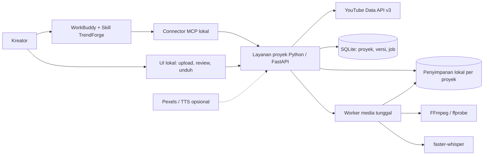

# PRD — TrendForge AI / Agent Creator

**Challenge C: The Creator Agent — Tencent Cloud Hackathon Indonesia 2026**

| Atribut | Nilai |
|---|---|
| Versi | 1.0 |
| Tanggal | 27 Oktober 2026 |
| Status | Draft lengkap untuk pelaksanaan MVP; belum merupakan bukti implementasi atau hasil uji |
| Pemilik produk | Project Lead TrendForge AI; nama penanggung jawab diisi tim |
| Mode PRD | Full — Why & Who → What & If → How & Next |
| Bahasa produk | Bahasa Indonesia |
| Periode MVP | 27 Oktober–1 November 2026, enam hari kalender |
| Deadline keras | **1 November 2026, 23:59 WIB (UTC+07:00)** |
| Target internal submit | 1 November 2026, 20:00 WIB; sisa waktu untuk kendala pengumpulan |
| Platform agent | Tencent WorkBuddy sebagai tempat interaksi, penalaran, dan pemanggilan tools |
| Produk akhir MVP | Brief/script dan MP4 vertikal dengan edit dasar serta subtitle Indonesia, diunduh untuk upload manual |

## Ringkasan dan keputusan dasar

TrendForge AI membantu kreator menemukan ide dari referensi YouTube, menyusun brief dan script, kemudian mengubah 3–5 video milik kreator menjadi satu video vertikal siap ditinjau dan diunggah. Agent di WorkBuddy mengatur rangkaian pekerjaan; FFmpeg memproses media; faster-whisper menghasilkan transkripsi ucapan Bahasa Indonesia. Pengguna tetap memeriksa brief, rencana potongan, subtitle, dan hasil akhir.

MVP membuktikan satu alur utuh: **niche → referensi YouTube → ide/brief/script → unggah 3–5 video → rencana edit otomatis → draft video dan subtitle → koreksi → MP4 akhir**. Batas produk sengaja kecil: satu operator lokal, satu pekerjaan media aktif, durasi output 30–60 detik, satu preset visual, tanpa upload otomatis ke platform sosial.

### Dasar dari pengguna dan asumsi

| Kategori | Isi | Perlakuan |
|---|---|---|
| Dikonfirmasi pengguna | Membantu kreator mencari ide dan menghemat waktu produksi video | Menjadi dasar masalah dan nilai produk |
| Dikonfirmasi pengguna | Ukuran sukses adalah kecepatan dan kemudahan membuat konten | Diterjemahkan menjadi satu metrik utama waktu penyelesaian serta metrik pendamping kemudahan |
| Ditentukan pengguna | WorkBuddy, YouTube Data API v3, 3–5 unggahan, FFmpeg, faster-whisper, subtitle Indonesia, MP4 vertikal | Scope wajib |
| Ditentukan pengguna | Pexels dan TTS bila sempat | P2; tidak menjadi syarat keberhasilan MVP |
| Ditentukan pengguna | MVP enam hari dan deadline 1 November 23:59 WIB | Batas waktu tetap |
| Izin proses | Pengguna mengizinkan penyusunan sekali jalan dan melewati persetujuan per bagian skill prd-write | Tidak ada klaim bahwa tiap bagian telah disetujui terpisah |
| Asumsi A-01 | Persona awal adalah kreator solo Indonesia yang membuat Shorts/Reels | Diuji melalui uji pengguna; bukan hasil riset pasar |
| Asumsi A-02 | Demo berjalan pada satu komputer Windows yang menjalankan WorkBuddy dan layanan lokal | Konfirmasi kompatibilitas pada hari pertama |
| Asumsi A-03 | Tim setara 1–3 orang; satu orang dapat merangkap semua peran | Jadwal berfokus pada urutan dependensi, tanpa mengandalkan tim besar |
| Asumsi A-04 | Target durasi, batas file, dan angka performa di dokumen ini adalah target desain | Dibuktikan melalui benchmark; tidak dianggap capaian aktual |
| Asumsi A-05 | Monetisasi belum ditentukan; prioritas hackathon adalah manfaat dan demo yang dapat diulang | Tidak ada pembayaran atau janji gratis tanpa batas |

### Konteks lomba dan sumber kebenaran

Challenge C dan pemakaian WorkBuddy tercantum pada halaman penyelenggara dan komunitas pendukung. Halaman AIClub menyebut pengumpulan karya 1 November 2026 dan penutupan pukul 23:59 WIB. Deadline pengguna tetap menjadi batas kerja tim. Sumber publik memiliki beberapa informasi acara yang berbeda; format berkas submission, rubric penilaian, dan kewajiban hosting harus dicocokkan dengan form/panduan panitia pada hari pertama. Dokumen ini tidak menganggap repository, slide, atau video demo sebagai persyaratan resmi sebelum diverifikasi. [S1][S2]

---

# Bagian 1 — Why & Who

## 1.1 Masalah, kondisi sekarang, dan hasil yang dituju

**Problem statement:** kreator yang ingin membuat video pendek perlu menemukan ide yang relevan, merencanakan isi, memilih potongan video, menyambungnya, dan menambahkan subtitle. Perpindahan alat serta pengulangan pekerjaan tersebut menyita waktu sebelum konten bisa dipublikasikan. Besarnya masalah belum diukur; validasi awal harus membandingkan alur yang biasa digunakan kreator dengan alur TrendForge.

| ID masalah | As-Is | To-Be | Nilai yang diharapkan |
|---|---|---|---|
| PP-01 | Kreator mencari referensi dan mencatat ide secara terpisah | Referensi dengan sumber dan waktu pengambilan tersedia bersama ide, brief, dan script | Lebih cepat memilih ide yang dapat dikerjakan |
| PP-02 | Kreator mengulang trim, menyamakan format, menyusun klip, dan memberi efek dasar | Satu rencana edit yang dapat diperiksa menghasilkan montage vertikal otomatis | Lebih sedikit langkah penyuntingan rutin |
| PP-03 | Kreator mengetik dan menyesuaikan subtitle secara manual | Ucapan dalam hasil edit ditranskripsi, lalu kreator mengoreksi teks sebelum ekspor | Mempercepat subtitle tanpa menghilangkan kontrol |
| PP-04 | Kreator tidak yakin proses gagal di mana atau hasilnya siap dipakai | Status, pesan pemulihan, preview, dan unduhan tersedia dalam satu proyek | Penyelesaian lebih mudah dan dapat dipulihkan |

**Why now:** pengguna memiliki kesempatan membangun dan mendemokan Creator Agent pada hackathon dalam enam hari. Ruang lingkup ini berangkat dari kebutuhan praktis kreator yang disebut pengguna dan tenggat lomba, bukan klaim bahwa pertumbuhan pasar atau tren industri tertentu telah terbukti.

**Proposisi nilai:** dari referensi ke file video dalam satu alur yang dipandu agent, menggunakan materi kreator sendiri dan kontrol sederhana. Keunggulan yang hendak dibuktikan adalah berkurangnya waktu serta beban langkah, bukan kemampuan menjamin viral atau menandingi editor profesional.

## 1.2 Persona, JTBD, dan stakeholders

| Peran | JTBD | Kebutuhan/konteks | Tanggung jawab dan risiko |
|---|---|---|---|
| Kreator solo Indonesia — utama | Ketika perlu menyiapkan Shorts/Reels, saya ingin menemukan ide dan merapikan rekaman dengan sedikit langkah agar bisa lebih cepat menerbitkan konten | Waktu terbatas, memiliki beberapa rekaman, ingin subtitle Indonesia, tidak ingin belajar timeline editor kompleks | Memilih ide, memastikan hak materi, meninjau isi dan hasil akhir |
| Operator demo / Project Lead | Ketika mendemokan solusi, saya ingin menjalankan contoh dari awal sampai akhir agar manfaat agent terlihat dan bisa diulang | Perlu setup yang jelas, data referensi asli, contoh video berizin, dan jalur pemulihan | Mengelola akses layanan, memastikan demo jujur dan submission tepat waktu |
| Penguji kreator | Ketika mencoba produk baru, saya ingin memahami langkah berikutnya dan mengunduh hasil tanpa bantuan pembuat | Instruksi Bahasa Indonesia dan tampilan progres yang jelas | Memberikan persetujuan penggunaan rekaman dan umpan balik |
| Juri/panitia — stakeholder | Perlu menilai manfaat dan peran agent dalam prototype | Alur serta bukti tools WorkBuddy terlihat, sumber data dijelaskan | Persyaratan penilaian mengikuti panduan resmi, tidak diasumsikan di PRD |

**Batas persona:** belum melayani agensi multiakun, tim editor bersamaan, organisasi dengan hak akses bertingkat, atau pengguna publik dalam skala besar.

## 1.3 Nilai bisnis dan time-to-value

Nilai utama yang dikonfirmasi pengguna adalah **mencari ide dan menghemat waktu produksi**. Hasil yang dianggap bernilai adalah konten yang berhasil diproduksi dan dianggap layak upload oleh kreatornya, bukan jumlah permintaan agent atau jumlah ide yang dihasilkan.

- Momen nilai awal: kreator menemukan satu ide yang sesuai kebutuhan serta menerima brief/script yang bisa digunakan.
- Momen nilai penuh: kreator menyetujui preview, mengunduh MP4, dan menyatakan hasil siap upload tanpa membuka editor lain.
- Risiko bila tidak dibangun: kreator tetap mengulang alur manual. Besarnya waktu yang hilang harus diukur, bukan diasumsikan.
- Biaya berpindah: produk harus menghasilkan file standar yang tetap dapat dipakai di alat lain; pengguna tidak dipaksa menyimpan konten di TrendForge.
- Model bisnis pascalomba: belum dipilih. Paket berlangganan, kredit render, dan penggunaan pribadi baru dipertimbangkan setelah manfaat teruji.
- Istilah “gratis”: library lokal dapat dipakai tanpa biaya per panggilan layanan STT, tetapi komputer, listrik, penyimpanan, akses model/WorkBuddy, dan layanan opsional tetap memiliki biaya atau kuota.

## 1.4 Ukuran sukses dan kontrak pengukuran

### Satu metrik utama / North Star Metric

**NSM: median waktu dari mulai tugas sampai video dinyatakan siap upload oleh kreator (Time to Ready Video / TTRV), dalam menit; lebih rendah lebih baik.**

Awal pengukuran adalah saat kreator memulai tugas “buat satu video” di WorkBuddy atau alur pembanding. Akhir pengukuran adalah ketika MP4 sudah diunduh dan kreator menyatakan hasil layak upload. Waktu mencakup riset, memilih ide, revisi, unggahan, pemrosesan, dan pemeriksaan. Waktu merekam footage baru tidak termasuk eksperimen MVP; kedua metode menggunakan bahan rekaman yang sudah tersedia. Instalasi awal serta unduhan model dipisahkan sebagai setup, tetapi tetap dicatat.

| Jenis | Definisi dan sumber | Populasi/denominator | Baseline dan jendela observasi | Target desain | Owner |
|---|---|---|---|---|---|
| NSM — TTRV | Median selisih `ready_confirmed_at - task_started_at`; gabungan event proyek dan konfirmasi kreator | Tugas yang selesai dan mendapat persetujuan kualitas; jumlah selesai/seluruh percobaan wajib dilaporkan bersama | Baseline manual 27–28 Okt; pengujian TrendForge 31 Okt–1 Nov; target 3 kreator, masing-masing 1 tugas manual dan 1 tugas produk | Median ≤20 menit dan ≥30% lebih cepat dari median baseline berpasangan, pada skenario rekaman siap pakai | Product/QA |
| Leading — kemudahan | Nilai jawaban “Seberapa mudah menyelesaikan tugas ini?” skala 1 sangat sulit–7 sangat mudah, setelah percobaan | Semua responden yang mencoba, termasuk yang gagal; laporkan jumlah respons | Pertanyaan sama pada baseline dan uji produk, periode di atas | Median ≥5/7; tidak ada pengguna yang memerlukan intervensi kode dari pembuat untuk selesai | Product/QA |
| Counter — completion | Tugas berakhir dengan MP4 diunduh dan dinyatakan siap upload / semua tugas yang dimulai | Semua percobaan uji, termasuk batal, timeout, dan gagal; data fixture dipisah | Satu percobaan produk utama per kreator; deadline observasi 1 Nov 16:00 WIB | Minimal 3/3 untuk gate demo kecil; bukan klaim reliabilitas populasi | QA |

Tidak ada metrik viralitas, views, subscribers, atau engagement pascapublikasi dalam evaluasi MVP. Angka di atas adalah target yang disintesis dari tujuan pengguna dan perlu diuji, bukan hasil penelitian. Dengan sampel kecil, laporkan nilai setiap percobaan dan rentang waktunya; jangan mengklaim signifikansi statistik.

**Aturan data:** waktu disimpan secara konsisten, ditampilkan dalam WIB; event tidak boleh dihitung dua kali. Reload atau retry tidak mereset awal tugas. Tugas berhenti pada batas observasi 30 menit dicatat sebagai gagal/tersensor, tanpa memasukkannya sebagai keberhasilan cepat. Waktu aktif pengguna dan waktu tunggu boleh dicatat sebagai diagnosis, bukan NSM tambahan. Jika seluruh tugas gagal, NSM dilaporkan tidak tersedia dan produk belum memenuhi gate.

Dalam uji pengguna, QA memulai stopwatch saat instruksi tugas diberikan dan mencatat waktu itu sebagai awal tugas pada lembar uji pendamping; jangan menggantinya dengan waktu proyek selesai dibuat. Stopwatch mencakup pengisian konteks awal dan perpindahan WorkBuddy/UI. `task_started_at` pada data proyek dikorelasikan dengan catatan ini, sedangkan `created_at` hanya menandai pembuatan record. Penghematan relatif dihitung `1 - median(TTRV produk) / median(TTRV manual)` pada peserta berpasangan yang memiliki kedua hasil; bila baseline tidak selesai dalam jendela observasi, laporkan sebagai tersensor dan jangan mengklaim persentase penghematan dari baseline tersebut.

### Hipotesis dan keputusan

| Elemen | Pernyataan |
|---|---|
| Hipotesis | Jika riset referensi, perencanaan, edit rutin, dan subtitle dipandu dalam satu alur, kreator lebih cepat menghasilkan video yang mereka nilai layak upload dan merasa prosesnya mudah |
| Yang divalidasi | Kecepatan, kemudahan, kualitas minimum hasil, pemulihan kesalahan, serta keberhasilan alur dengan bahan sudah tersedia |
| Tidak divalidasi | Product-market fit, pertumbuhan kanal, viralitas, pendapatan kreator, editor profesional, atau operasi SaaS |
| Lanjut | Semua P0 lolos; tiga uji produk selesai; target waktu dan kemudahan tercapai |
| Iterasi | Alur selesai tetapi target waktu/kemudahan gagal; perbaiki tahap terlama sebelum menambah fitur |
| Tahan perluasan | Ada kebocoran data, hasil rusak, subtitle menyesatkan tanpa mekanisme review, atau completion gagal; perbaiki P0 dan jangan mengaktifkan P2 |

Confounder utama: pengalaman mengedit berbeda, peserta sudah mengenal produk, bahan kedua lebih mudah, atau model/cache sudah dipanaskan. Gunakan dua set klip berizin yang setara, acak urutan metode bila memungkinkan, catat apakah model sudah siap, gunakan kriteria kualitas yang sama, dan hindari membandingkan proses manual penuh dengan demo replay produk.

---

# Bagian 2 — What & If

## 2.1 Janji produk dan definisi selesai

**Core user story:** sebagai kreator video pendek, saya ingin mengubah topik dan 3–5 rekaman menjadi ide, rencana, serta video bersubtitle agar saya bisa membuat konten dengan lebih cepat dan sedikit langkah; karena jika harus memindahkan pekerjaan ke beberapa alat, waktu produksi saya bertambah.

“Siap upload” berarti: MP4 dapat diputar sampai akhir, sesuai spesifikasi vertikal, ucapan dan gambar sinkron, subtitle telah ditinjau, tidak ada bagian kosong yang tidak disengaja, dan kreator menyetujui isinya. Ini tidak menjamin penerimaan platform, hak atas seluruh konten, kelayakan monetisasi, atau kualitas viral.

### Kontrak scope MVP

| Aspek | Batas P0 |
|---|---|
| Penggunaan | Satu operator pada instalasi lokal; satu proyek dikerjakan pada satu waktu, beberapa proyek boleh disimpan |
| Riset | Region ID, bahasa preferensi Indonesia, satu niche/kueri, periode 7 hari default; pengguna dapat memilih 1 atau 30 hari |
| Referensi | Sampai 20 kandidat per pencarian; tidak menjanjikan semua tren atau seluruh Shorts |
| Ide | 3 ide, dipilih 1 untuk brief/script; ide diberi label usulan AI |
| Bahan wajib | 3–5 video unggahan kreator; stok tidak menggantikan syarat jalur utama |
| Batas unggahan | Maksimal 100 MiB/file dan 500 MiB/proyek; tiap file 3–120 detik; total ≤600 detik; total durasi bahan ≥durasi output |
| Format input | MP4/MOV dengan video H.264, audio AAC atau PCM bila ada; minimum sisi pendek 360 piksel, maksimum sisi panjang 1920 piksel; rotasi ponsel dihormati |
| Bahan tidak didukung | HEVC, 4K, DRM, file rusak, atau codec lain ditolak dengan instruksi konversi; dukungan tambahan hanya sesudah P0 |
| Output | Pilihan 30, 45, atau 60 detik; default 30; satu file vertikal 1080×1920, 30 fps |
| Edit otomatis | Satu segmen per bahan, urutan awal mengikuti unggahan; durasi dialokasikan otomatis agar total sesuai target, dapat dikoreksi lewat rencana sederhana |
| Efek wajib | Fade-in/fade-out awal/akhir video, transisi antarklip berupa cut; penyesuaian ukuran tanpa distorsi |
| Framing | Fit + padding warna gelap, tanpa memotong sisi gambar; bukan pelacakan subjek |
| Audio | Pertahankan audio asli yang dipilih dalam rencana; volume dirapikan; file tanpa audio disambung sebagai hening |
| Subtitle | Transkripsi ucapan Indonesia dari audio hasil susunan final, teks dapat dikoreksi; burn-in pada MP4 dan SRT terpisah |
| Kendali pengguna | Persetujuan brief, persetujuan rencana edit, review subtitle, preview akhir, unduh |
| Distribusi | Upload manual ke YouTube Shorts/Instagram Reels; tidak perlu login kanal sosial |

Batas file dan output adalah keputusan desain MVP, bukan batas maksimum resmi platform sosial. Materi di luar batas diarahkan untuk dikonversi/diperkecil terlebih dahulu.

## 2.2 Functional requirements — user stories, prioritas, dan acceptance criteria

Semua P0 wajib sebelum submission. P1 hanya setelah P0 aman, P2 hanya bila masih ada buffer. Format AC adalah Given/When/Then dalam Bahasa Indonesia; “Field” di bawah menjelaskan data yang terlihat bagi pengguna. Detail teknis berada di Lampiran B.

### Must Have — P0

#### US-01 — Memulai proyek dari tujuan konten

Sebagai kreator solo, saya ingin menyebut niche, audiens, dan tujuan video agar agent memberi saran yang sesuai; karena referensi tanpa konteks membuat saya harus mengulang pencarian.

- **AC-01-01 — Happy path:** Jika sesi siap, saat saya mengisi tujuan valid, proyek tercipta dan ringkasan kebutuhan beserta langkah berikutnya muncul di WorkBuddy.
  - Field: niche teks wajib 2–100 karakter; audiens teks wajib 2–200; tujuan teks wajib 5–500; platform Shorts/Reels/both wajib, default both; durasi 30/45/60 detik wajib, default 30.
  - Verifikasi: mulai satu proyek; cocokkan ringkasan dengan input dan buka halaman proyek.
- **AC-01-02 — Reverse:** Jika belum menyimpan proyek, saat saya membatalkan, tidak ada proyek baru; proyek lama tetap tersedia.
  - Field: tindakan batal; identitas proyek lama opsional, tidak berubah.
  - Verifikasi: batalkan formulir dan periksa daftar proyek.
- **AC-01-03 — Error:** Jika niche atau tujuan kosong/tidak valid, saat saya lanjut, tampil koreksi spesifik dan input lain tetap tersimpan.
  - Field: pesan validasi per input; nilai valid tetap dipertahankan.
  - Verifikasi: kosongkan tujuan lalu lanjut; pastikan tidak terjadi riset otomatis.

#### US-02 — Mendapat referensi YouTube yang dapat diperiksa

Sebagai kreator, saya ingin melihat contoh video terbaru yang relevan serta sumbernya agar dapat memilih inspirasi; karena angka popularitas tanpa konteks dapat menyesatkan saya.

- **AC-02-01 — Happy path:** Jika niche valid dan layanan tersedia, saat saya meminta riset, tampil sampai 20 kandidat berisi judul, kanal, tanggal terbit, tautan, thumbnail bila tersedia, statistik yang tersedia, waktu pengambilan, serta jenis sumber pencarian/chart. Data tidak dilabeli “semua tren”.
  - Field: periode 1/7/30 hari wajib; region ID wajib; jumlah kandidat 0–20; statistik yang tidak tersedia ditulis “tidak tersedia”, bukan nol.
  - Verifikasi: bandingkan minimal 3 kandidat dengan respons sumber; buka tautannya; cek label cakupan.
- **AC-02-02 — Reverse:** Jika referensi sudah tampil, saat niche/periode diganti, hasil lama tetap dapat dilihat sebagai riset sebelumnya dan hasil baru tidak menimpa sumber brief yang telah disetujui.
  - Field: versi riset dan waktu pengambilan wajib; referensi terpilih dipertahankan pada brief lama.
  - Verifikasi: ganti niche setelah brief dibuat; cek versi lama masih dapat ditelusuri.
- **AC-02-03 — Error:** Jika kuota habis, jaringan gagal, atau hasil kosong, tampil penjelasan serta pilihan retry, cache bertanggal bila ada, atau lanjut dengan topik manual. Data contoh/cache tidak diklaim sebagai data live.
  - Field: mode live/cache/manual wajib; umur cache wajib jika dipakai; pesan pemulihan wajib.
  - Verifikasi: uji ketiga kondisi; lanjut manual tidak menampilkan sumber YouTube fiktif.

#### US-03 — Memilih ide dan memperoleh brief/script

Sebagai kreator, saya ingin menerima beberapa ide lalu satu brief yang jelas agar cepat menentukan apa yang akan dibuat; karena daftar referensi saja belum menjadi rencana produksi.

- **AC-03-01 — Happy path:** Jika konteks tersedia, saat saya meminta ide, muncul 3 usulan berbeda; setelah saya memilih satu, agent menghasilkan brief dan script Bahasa Indonesia dengan hook, audiens, angle, 3–5 beat/shot, CTA, durasi, serta referensi terpilih bila mode riset dipakai.
  - Field: ide terpilih tepat 1; hook/angle/CTA teks wajib; beat/shot 3–5 wajib; sumber minimal 1 pada mode riset dan kosong pada mode manual; semua usulan berlabel AI.
  - Verifikasi: pilih satu ide; cek kelengkapan, tautan sumber, dan estimasi script sesuai 30/45/60 detik melalui pembacaan nyata.
- **AC-03-02 — Reverse:** Jika brief belum disetujui, saat saya kembali memilih ide, agent membuat draft baru dan belum memulai pekerjaan media.
  - Field: status brief draft; konfirmasi pengguna belum diberikan.
  - Verifikasi: ganti pilihan ide; pastikan tidak ada render atau konsumsi media otomatis.
- **AC-03-03 — Error:** Jika jawaban AI tidak lengkap atau tidak dapat diproses, ditawarkan satu regenerasi atau pengisian manual; draft sebelumnya tidak hilang dan sumber tidak dikarang.
  - Field: bagian yang kurang wajib ditunjukkan; input manual mengikuti field happy path.
  - Verifikasi: berikan keluaran AI tanpa CTA; sistem meminta koreksi dan menolak persetujuan sampai lengkap.

#### US-04 — Merevisi dan menyetujui brief

Sebagai kreator, saya ingin mengubah draft sebelum menggunakannya agar hasil sesuai gaya saya; karena saya tetap bertanggung jawab atas isi konten.

- **AC-04-01 — Happy path:** Jika brief draft ada, saat saya mengubah teks lalu menyetujui, versi yang disetujui terlihat jelas dan dipakai pada rencana berikutnya.
  - Field: isi revisi mengikuti US-03; status draft/approved; waktu persetujuan wajib ketika approved.
  - Verifikasi: ubah hook; setujui; periksa rencana merujuk versi tersebut.
- **AC-04-02 — Reverse:** Jika revisi belum disimpan, saat dibatalkan, versi tersimpan terakhir tetap berlaku.
  - Field: revisi belum tersimpan dibuang; versi tersimpan tidak berubah.
  - Verifikasi: edit lalu batal; muat ulang dan bandingkan teks.
- **AC-04-03 — Error:** Jika brief diubah setelah rencana/video dibuat, persetujuan hilir dicabut dan hasil terdahulu diberi label versi lama; tidak ditampilkan sebagai hasil brief baru.
  - Field: label versi lama wajib; persetujuan rencana/subtitle/ekspor baru memerlukan konfirmasi ulang.
  - Verifikasi: ubah durasi setelah draft video; cek ekspor langsung diblokir sampai rencana diperbarui.

#### US-05 — Mengunggah 3–5 rekaman

Sebagai kreator, saya ingin memasukkan beberapa rekaman saya agar materi sendiri dapat dirapikan otomatis; karena menata bahan satu per satu di editor memerlukan waktu.

- **AC-05-01 — Happy path:** Jika proyek dan brief disetujui, saat saya mengunggah 3–5 file sesuai kontrak scope, terlihat progres per file, nama, durasi, orientasi, serta ada/tidaknya audio; rencana edit dapat dibuat setelah seluruh bahan valid.
  - Field: jumlah file 3–5; ukuran, durasi, format mengikuti 2.1; konfirmasi hak penggunaan wajib satu kali per proyek.
  - Verifikasi: unggah 3 video campuran portrait/landscape berizin; lihat semua metadata dan langkah berikutnya.
- **AC-05-02 — Reverse:** Jika satu unggahan sedang berlangsung atau bahan belum dipakai pekerjaan aktif, saat saya membatalkan/menghapus bahan, file tersebut tidak dipakai; bahan valid lain tetap tersedia. Rencana yang memakai bahan dihapus perlu dibuat ulang.
  - Field: bahan terpilih tepat 1 per aksi; jumlah valid dihitung ulang; konfirmasi penghapusan wajib.
  - Verifikasi: batalkan satu unggahan lalu hapus satu bahan; tidak ada file parsial dihitung valid.
- **AC-05-03 — Error:** Jika file terlalu besar, rusak, codec tidak didukung, atau jumlah melebihi 5, tampil alasan spesifik dan cara memperbaiki; bahan lain serta brief tetap tersimpan.
  - Field: nama file dan alasan wajib; file gagal tidak masuk hitungan valid.
  - Verifikasi: uji file oversize, HEVC, file palsu, file keenam, serta total bahan kurang dari durasi output.

#### US-06 — Mendapat rencana trim/merge/effects otomatis

Sebagai kreator, saya ingin agent menyiapkan urutan dan potongan yang dapat saya periksa agar tidak perlu mengatur timeline rumit; karena penyusunan dasar dapat menghabiskan waktu.

- **AC-06-01 — Happy path:** Jika 3–5 bahan valid tersedia, saat saya meminta rencana, muncul urutan klip, awal/akhir potongan, perkiraan durasi final, framing, audio, dan preset efek; setelah persetujuan, sistem membuat draft vertikal serta subtitle awal.
  - Field: segmen 3–5, satu per bahan; awal ≥0 detik, akhir ≤durasi bahan, akhir >awal; total potongan sama dengan target; preset simple_fade; framing fit_pad.
  - Verifikasi: setujui rencana; putar draft dan cocokkan urutan, panjang, framing, serta fade awal/akhir.
- **AC-06-02 — Reverse:** Jika rencana belum diproses, saat saya mengganti urutan atau batas potongan di formulir sederhana, estimasi diperbarui dan persetujuan ulang diperlukan. Membatalkan perubahan mempertahankan rencana tersimpan.
  - Field: urutan unik; awal/akhir sesuai batas bahan; jumlah durasi sesuai target.
  - Verifikasi: tukar dua klip, ubah trim, kemudian batal/simpan; cek hasil masing-masing.
- **AC-06-03 — Error:** Jika batas potongan tidak valid atau total bahan tidak cukup, tampil bahan mana yang perlu diperbaiki; sistem tidak menggandakan atau membekukan frame untuk berpura-pura mencapai durasi.
  - Field: bahan bermasalah dan selisih durasi wajib; opsi tambah/ganti bahan atau target lebih pendek bila masih ≥30 detik.
  - Verifikasi: buat potongan melewati akhir file dan rencana kurang panjang; tidak ada draft dianggap selesai.

#### US-07 — Memeriksa dan mengoreksi subtitle Indonesia

Sebagai kreator, saya ingin subtitle mengikuti ucapan dan dapat diperbaiki agar hasil tetap akurat; karena salah kata dapat mengubah maksud konten.

- **AC-07-01 — Happy path:** Jika draft bersuara tersedia, saat transkripsi selesai, teks ditampilkan per rentang waktu bersama preview; setelah koreksi dan persetujuan, teks yang disetujui dipakai pada video final dan SRT.
  - Field: bahasa id; teks per cue wajib tidak kosong; waktu mulai/akhir di dalam durasi video; urutan cue tidak bertumpuk; maksimal 2 baris per cue saat ditampilkan.
  - Verifikasi: ubah satu nama/kata; lihat koreksi pada hasil burn-in dan SRT serta sinkronisasinya.
- **AC-07-02 — Reverse:** Jika teks sedang direvisi, saat saya membatalkan, versi tersimpan tetap ada. Mengubah potongan video membatalkan persetujuan subtitle dan meminta transkripsi/review baru.
  - Field: versi subtitle terkait draft video tertentu; persetujuan tidak dapat dipakai lintas timeline.
  - Verifikasi: edit lalu batal, kemudian ubah trim; periksa subtitle lama tidak dipakai otomatis.
- **AC-07-03 — Error/hening:** Jika tidak ada ucapan terdeteksi, sistem menampilkan “Tidak ada ucapan terdeteksi” dan tidak membuat kalimat fiktif; pengguna boleh menyetujui hasil tanpa subtitle. Jika STT gagal pada audio bersuara, pengguna dapat retry atau mengisi cue manual sebelum lanjut.
  - Field: kondisi no_speech/transcription_failed; keputusan tanpa subtitle wajib eksplisit hanya pada no_speech; cue manual mengikuti batas waktu happy path.
  - Verifikasi: uji audio hening, musik, dan STT gagal; script usulan tidak menggantikan ucapan video.

#### US-08 — Mengekspor dan mengunduh hasil

Sebagai kreator, saya ingin memperoleh satu MP4 vertikal yang sudah dirapikan agar dapat saya upload tanpa editor tambahan; karena hasil berupa rencana saja belum menghemat pekerjaan akhir.

- **AC-08-01 — Happy path:** Jika draft dan subtitle telah disetujui atau no_speech disetujui, saat saya ekspor, MP4 final dan SRT bila ada tersedia untuk preview dan unduh. MP4 beresolusi 1080×1920, 30 fps, H.264/yuv420p, audio AAC 48 kHz stereo, sesuai target dengan toleransi 0,1 detik dan dapat diputar sampai akhir.
  - Field: format MP4; target durasi 30/45/60 detik; nama file aman; label versi brief/rencana/subtitle; SRT opsional hanya jika cue tidak kosong.
  - Verifikasi: inspeksi media, putar seluruh video, unduh dan buka di perangkat lain; periksa sampel awal, tengah, akhir dan semua sambungan.
- **AC-08-02 — Reverse:** Jika hasil final tersedia, saat saya kembali mengedit, hasil lama tetap dapat diunduh sebagai versi lama sampai pengguna menghapus proyek; hasil baru tidak menimpa file yang sedang diunduh.
  - Field: versi hasil wajib; status current/older wajib; unduhan ulang tidak dihitung sebagai penyelesaian baru.
  - Verifikasi: unduh ulang, revisi, dan ekspor ulang; cek kedua file dapat dibedakan.
- **AC-08-03 — Error:** Jika ekspor/validasi gagal atau ruang disk habis, hasil parsial tidak ditawarkan sebagai final; draft dan persetujuan yang masih relevan dipertahankan, lalu tersedia retry setelah penyebab diperbaiki.
  - Field: tahap gagal, pesan dan tindakan pemulihan wajib.
  - Verifikasi: simulasikan disk penuh dan proses render gagal; tidak ada tautan hasil rusak berstatus siap.

#### US-09 — Memantau, membatalkan, dan memulihkan pekerjaan

Sebagai kreator, saya ingin tahu progres serta melanjutkan proyek setelah gangguan agar tidak mengulang dari awal; karena pemrosesan video memerlukan waktu tunggu.

- **AC-09-01 — Happy path:** Jika pemrosesan berjalan, tampil tahap, status, lama waktu berjalan, dan langkah berikutnya. Saat halaman dimuat ulang, proyek dan status tersimpan kembali terlihat; progres angka hanya ditampilkan bila dapat diukur.
  - Field: tahap queued/preparing/transcribing/exporting/validating; status dan waktu mulai wajib; estimasi selesai opsional dengan label perkiraan.
  - Verifikasi: reload ketika draft dibuat; pastikan satu pekerjaan tetap berjalan dan status konsisten di WorkBuddy/UI.
- **AC-09-02 — Reverse:** Jika pekerjaan antre/berjalan, saat saya membatalkan, status menjadi dibatalkan setelah proses berhenti, tidak ada final baru, dan input tetap tersedia. Batal bukan pause/resume byte-level.
  - Field: status cancelling/cancelled; bahan valid dan draft tersimpan tidak dihapus.
  - Verifikasi: batal saat antre dan render; periksa proses berhenti dan dapat dimulai lagi dari checkpoint yang valid.
- **AC-09-03 — Error:** Jika layanan berhenti, saat dibuka kembali pekerjaan yang terputus ditandai gagal dengan alasan jelas dan dapat diulang. Permintaan mulai berulang tidak menghasilkan dua pekerjaan aktif untuk proyek yang sama.
  - Field: status failed, alasan interrupted; identitas pekerjaan yang sama untuk pengulangan permintaan identik.
  - Verifikasi: hentikan layanan saat proses, jalankan lagi, retry; hitung pekerjaan dan cek tidak ada “selesai” palsu.

#### US-10 — Menghapus materi proyek

Sebagai pemilik rekaman, saya ingin menghapus proyek beserta media lokal agar dapat mengendalikan penyimpanan materi saya; karena rekaman tidak boleh tertinggal tanpa saya sadari.

- **AC-10-01 — Happy path:** Jika proyek tidak menjalankan pekerjaan aktif, saat saya mengonfirmasi hapus, proyek, input, draft, subtitle, dan hasil di penyimpanan aplikasi tidak dapat diakses lagi. Salinan yang sudah saya unduh di luar aplikasi tidak dihapus.
  - Field: proyek terpilih wajib; konfirmasi hapus wajib; cakupan penghapusan ditampilkan.
  - Verifikasi: hapus proyek uji; periksa daftar, tautan lama, metadata, dan direktori media aplikasi.
- **AC-10-02 — Reverse:** Jika dialog hapus terbuka, saat saya batal, seluruh data tetap ada.
  - Field: tindakan batal; tidak ada perubahan status.
  - Verifikasi: batalkan dialog lalu putar hasil yang ada.
- **AC-10-03 — Error:** Jika pekerjaan masih berjalan, diminta membatalkan pekerjaan dahulu. Jika sebagian file tidak bisa dihapus, tampil kegagalan dan retry; jangan mengklaim seluruh materi telah dihapus.
  - Field: status deletion_failed bila relevan; daftar kategori file yang gagal tanpa membocorkan path rahasia.
  - Verifikasi: uji pekerjaan aktif dan file terkunci; perbaiki lalu retry penghapusan.

### Should Have — P1

| Story | Tujuan | AC minimum jika diaktifkan |
|---|---|---|
| US-11 — Paket teks publikasi | Sebagai kreator, saya ingin menyalin judul/caption/hashtag usulan agar persiapan upload lebih cepat | Setelah brief disetujui, tampil teks dapat diedit dan disalin; Field: judul/caption teks, hashtag daftar maksimal 5, label usulan AI; Verifikasi: salin dan cocokkan. Saat batal edit kembali ke versi tersimpan; bila generasi gagal, brief/video tetap tersedia |
| US-12 — Bantuan pembacaan video | Sebagai kreator, saya ingin ukuran subtitle dapat dipilih agar tetap terbaca | Pilihan normal/besar mengubah preview dan burn-in; Field: ukuran enum wajib, default normal; Verifikasi: bandingkan dua ekspor. Batal mengembalikan pilihan lama; font hilang menghasilkan error yang dapat dipulihkan, bukan teks hilang |

### Could Have — P2, opsional ketat

| Story | Tujuan | AC minimum jika diaktifkan | Syarat aktivasi |
|---|---|---|---|
| US-13 — Pexels stock footage | Sebagai kreator, saya ingin memilih footage pelengkap berlisensi ketika bahan kurang bervariasi | Pencarian menampilkan preview, pembuat, tautan Pexels dan pilihan file; impor hanya setelah dipilih; Field: ID stok, sumber, pembuat, tautan, file, keterangan lisensi; Verifikasi: telusuri asal file pada proyek/manifest. Batal tidak mengimpor; kuota/error kembali ke unggahan sendiri | Seluruh P0 lolos dan buffer ≥4 jam pada 31 Okt; tetap total 3–5 bahan pada alur opsi yang diaktifkan |
| US-14 — TTS Indonesia | Sebagai kreator, saya ingin membuat voiceover dari script yang disetujui jika tidak punya narasi | Dengarkan preview lalu setujui; Field: naskah, bahasa id, suara bawaan berizin, durasi audio; Verifikasi: subtitle mengikuti audio TTS yang benar-benar dipakai. Batal mempertahankan audio asli; gagal kembali ke alur audio asli | Setelah US-13 atau sebagai pengganti prioritas P2; provider, lisensi, dan kuota harus dipilih lebih dahulu; bukan voice cloning |

Tidak mengaktifkan P2 tidak membuat MVP gagal. TTS yang lebih panjang dari target meminta pemendekan/regenerasi, bukan memotong narasi diam-diam. Jika TTS belum tersedia, video hening tetap mengikuti US-07 tanpa janji voiceover.

### Won't Have — P3 / explicit out of scope

| Di luar scope MVP | Alasan | Ditinjau kembali ketika |
|---|---|---|
| Unduh/rip video, audio, atau subtitle publik YouTube | API riset bukan sumber bahan edit; hak dan pembatasan akses berbeda | Hanya dengan mekanisme resmi dan otorisasi yang sesuai; scraping/ripping tetap bukan jalur produk |
| Semua tren YouTube/IG/TikTok real time, skor viral, prediksi views | Cakupan data tidak mendukung janji tersebut | Sumber resmi, hak penggunaan, dan evaluasi tersedia |
| Auto-upload, penjadwalan, OAuth kanal sosial | Bukan inti bukti manfaat enam hari | Setelah MVP stabil dan integrasi platform disetujui |
| Text-to-video generatif atau video AI gratis tanpa batas | Biaya, latency, dan hak aset tidak dapat dijamin | Ada kebutuhan teruji serta anggaran/provider |
| Editor timeline profesional, multi-track, keyframes, undo tak terbatas | Scope terlalu besar | Pengujian membuktikan kebutuhan inti |
| Pemahaman visual penuh, best-moment detection, tracking wajah, auto-reframe | Membutuhkan model dan evaluasi tambahan | Edit dasar terbukti bermanfaat |
| Efek sinematik kompleks, motion graphics, beat sync, transisi antarklip selain cut | Tidak diperlukan untuk hasil dasar | Kualitas P0 dan waktu render memenuhi target |
| 4K/HEVC, video panjang, output landscape/square, batch render | Melipatgandakan variasi pemrosesan | Ada benchmark dan kapasitas |
| Subtitle multibahasa, terjemahan, diarization, karaoke per kata | Bukan prioritas bahasa MVP | Akurasi Indonesia telah divalidasi |
| Akun publik, multi-tenant, kolaborasi bersamaan, billing, aplikasi mobile native | MVP lokal satu pengguna | Tahap produk terpisah dengan keamanan produksi |
| Analitik performa kanal, eksperimen judul, scraping komentar | Tidak perlu untuk alur inti | Sumber dan tujuan penggunaan terverifikasi |

## 2.3 Workflows

### UC-01 — Jalur utama lengkap

1. Kreator membuka WorkBuddy, menjalankan skill TrendForge, menyebut niche/audiens/tujuan. Agent merangkum dan membuat proyek.
2. Agent memanggil tool riset. Kreator melihat hasil dari YouTube, cakupan/periode/waktu, lalu memilih referensi atau menerima saran referensi.
3. WorkBuddy menyusun 3 ide; kreator memilih satu. WorkBuddy menyimpan brief/script melalui tool terstruktur, menampilkan draft, lalu kreator merevisi dan menyetujui versi yang terlihat di UI lokal.
4. Agent memberikan tautan UI lokal untuk proyek tersebut. Kreator mengonfirmasi hak materi dan mengunggah 3–5 rekaman. Brief boleh digunakan untuk merekam materi baru di luar pengukuran MVP.
5. UI menunjukkan metadata bahan. Kreator kembali ke WorkBuddy dan menyatakan bahan siap; agent membaca daftar bahan dan menyiapkan rencana edit. Tidak ada asumsi bahwa WorkBuddy dapat menerima file video besar langsung di chat.
6. Kreator memeriksa urutan, batas potongan, framing, dan audio, lalu menyetujui. Tool persiapan mengembalikan identitas job segera.
7. Worker membuat montage draft sesuai timeline final, mengekstrak audio montage tersebut, kemudian mentranskripsi audio. Dengan demikian cue subtitle mengikuti waktu hasil edit, bukan waktu file sumber.
8. UI menampilkan preview draft dan cue. Kreator mengoreksi subtitle, meninjau suara/gambar, lalu menyetujui. Draft sebelum burn-in boleh menampilkan subtitle sebagai overlay preview.
9. Kreator/agent meminta ekspor final. Worker membakar subtitle yang disetujui, memvalidasi media, kemudian menyediakan MP4 dan SRT.
10. Kreator memutar preview akhir, mengunduh, lalu menekan “Siap upload”. Sistem mencatat akhir tugas. Kreator upload sendiri ke platform pilihannya.

**Penting:** script merupakan panduan produksi, bukan pengganti ucapan rekaman. Produk tidak menjamin rekaman lama cocok dengan script atau mendeteksi semua ketidakcocokan visual. UI meminta kreator memeriksa kecocokan materi.

### UC-02 — Mode manual/cache ketika riset gagal

Trigger: kuota, jaringan, atau hasil niche kosong. Agent menjelaskan keterbatasan, menawarkan cache dengan tanggal asli atau topik manual, kemudian melanjutkan brief. `research_mode=manual` tidak menampilkan statistik atau referensi YouTube yang dikarang. Demo dengan cache diberi label replay/cache; gate integrasi tetap memerlukan satu percobaan live yang dibuktikan.

### UC-03 — Revisi dan proses ulang

| Perubahan | Tetap tersedia | Wajib diulang/disetujui |
|---|---|---|
| Ubah teks brief/audiens/script | Bahan, riwayat brief, hasil lama | Brief disetujui ulang; rencana dikonfirmasi ulang; hasil final lama ditandai older |
| Ubah target durasi, bahan, urutan, atau trim | Brief dan bahan yang masih valid | Rencana baru, montage baru, transkripsi, review, ekspor |
| Ubah cue subtitle saja | Brief, bahan, rencana, montage/audio yang sama | Review subtitle dan ekspor burn-in |
| Ubah ukuran teks P1 | Semua sumber dan cue | Preview/ekspor baru serta persetujuan hasil |
| Retry job gagal tanpa perubahan input | Checkpoint valid yang terkait versi input yang sama | Tahap gagal dan tahap hilir; tidak melakukan riset ulang |

Tidak ada merge otomatis terhadap perubahan dua tab. Saat pekerjaan media aktif, perubahan brief, bahan, rencana, atau subtitle diblokir sampai pekerjaan selesai/dibatalkan; UI menampilkan alasannya. Perubahan pada tab dengan versi lama ditolak dan diminta memuat ulang.

### UC-04 — Batal, tutup, kembali

- Batal formulir yang belum disimpan: kembali ke versi tersimpan.
- Menutup UI: pekerjaan layanan boleh berlanjut; membuka URL proyek memulihkan status. Ini tidak menjanjikan proses tetap hidup jika komputer tidur/mati.
- Batal job: berhentikan proses dengan tertib, pertahankan bahan dan checkpoint valid, hapus file parsial yang tidak digunakan.
- Restart layanan: tandai job aktif sebelumnya interrupted/failed; retry eksplisit, bukan melanjutkan proses yang sebenarnya sudah mati.
- Hapus proyek: hentikan job dahulu, minta konfirmasi cakupan, hapus data aplikasi. Riwayat percakapan WorkBuddy dan salinan unduhan berada di luar kendali layanan; jelaskan di UI.

### Edge cases dan pesan pemulihan

| Skenario | Pesan/hasil yang terlihat | Pemulihan |
|---|---|---|
| API key belum siap/invalid | “Riset YouTube belum tersambung. Periksa pengaturan atau lanjutkan topik manual.” | Operator memperbaiki konfigurasi; input tetap ada |
| YouTube quota exceeded | “Kuota riset habis. Data tersimpan bertanggal … dapat dipakai sebagai referensi.” | Cache berlabel atau manual; tidak retry tanpa batas |
| Data statistik tidak ada | “Tidak tersedia” | Tetap tampilkan referensi dengan field lain |
| Sumber dihapus/private | Referensi tidak tersedia dan waktu pemeriksaan | Pilih sumber lain; jangan menyalin metadata lama seolah masih live |
| Upload putus | “Unggahan [nama] belum selesai.” | Retry file itu; file lain tidak diulang |
| Input 2 atau 6 video | “Gunakan 3–5 video untuk MVP ini.” | Tambah/hapus sebelum membuat rencana |
| Tidak ada ucapan | “Tidak ada ucapan terdeteksi. Lanjutkan tanpa subtitle?” | Konfirmasi eksplisit atau ganti bahan |
| Campur Indonesia/Inggris, nama produk | Tandai hasil sebagai transkripsi otomatis yang perlu ditinjau | Koreksi cue sebelum ekspor |
| Portrait/landscape bercampur | Fit pada kanvas vertikal dengan padding | Tinjau preview; tidak ada crop tersembunyi |
| Audio salah level/sinkron | Preview memperlihatkan masalah; final belum disetujui | Perbaiki normalisasi/timeline lalu buat draft ulang |
| Double click mulai job | Satu job yang sama atau pemberitahuan job aktif | Lihat progres job tersebut |
| Disk tidak cukup | “Ruang penyimpanan tidak cukup; kosongkan ruang lalu coba lagi.” | Bersihkan proyek lain; jangan hapus sumber aktif otomatis |
| FFmpeg/STT timeout/crash | Tahap gagal dan tombol retry | Pertahankan checkpoint valid; diagnosis operator tanpa membocorkan rahasia |

## 2.4 Aturan bisnis, izin, dan sumber data

1. Kreator menguasai keputusan isi dan persetujuan; agent tidak memberi persetujuan atas namanya. Untuk P0, event persetujuan brief/rencana/subtitle hanya berasal dari aksi operator di UI lokal. Jawaban setuju di chat diarahkan ke halaman review; connector tidak memiliki izin menetapkan approval.
2. Riset mengembalikan referensi publik yang tersedia melalui API, bukan klaim representasi seluruh YouTube. `regionCode=ID` pada pencarian berarti dapat dilihat di Indonesia, bukan bukti kreator berasal dari Indonesia; preferensi bahasa bukan filter eksklusif. [S5]
3. Penentuan potongan P0 berbasis durasi/urutan dan instruksi pengguna. Default mengambil rentang awal yang valid dengan pembagian durasi, lalu memberi kontrol koreksi. Tidak ada janji pemilihan adegan terbaik atau pemahaman isi visual.
4. Efek P0 adalah fade awal/akhir dan cut antarklip. Jumlah durasi potongan sama dengan target karena tidak ada overlap transisi; menambah crossfade kelak memerlukan perubahan perhitungan durasi.
5. Subtitle mengikuti audio montage; jika naskah usulan berbeda, jangan menulis naskah itu sebagai transkripsi.
6. Rencana, subtitle, dan hasil selalu merujuk versi input tertentu. Persetujuan usang tidak dapat dipakai untuk memproses versi baru.
7. Satu pekerjaan media aktif per instalasi. Riset/brief dapat dibaca saat job aktif; perubahan input job diblokir. Job baru mendapat penjelasan “Sedang memproses video lain”, bukan antrean tanpa batas.
8. Sumber kebenaran status adalah layanan proyek, bukan teks percakapan agent. WorkBuddy hanya menyatakan “selesai” jika tool mengembalikan hasil tervalidasi.
9. Metadata YouTube ditampilkan dengan atribusi sumber/tautan; teks kreatif AI diberi label terpisah. Tidak ada skor viral, perhitungan views/jam, penggabungan statistik lintas kanal, atau jaminan pertumbuhan. Kebijakan derived data dan pemrosesan metadata oleh model harus diverifikasi sebelum distribusi publik. [S7]
10. P0 menyimpan materi dan metadata proyek lokal sampai pengguna menghapusnya; UI memperlihatkan penggunaan disk dan pengingat penghapusan. Log diagnostik disimpan maksimal 7 hari. Cache YouTube dipakai ulang otomatis maksimal 1 jam untuk permintaan yang sama; setelah itu hanya boleh dipilih pengguna sebagai riwayat bertanggal, dengan label data lama dan konfirmasi sebelum dipakai. Refresh/delete metadata dan statistik API paling lambat 30 hari, termasuk salinan pada riset/brief; tidak membangun arsip statistik historis. [S7]

| Peran | Boleh | Tidak boleh |
|---|---|---|
| Kreator/operator lokal terautentikasi | Buat proyek, unggah, revisi, setujui, proses, batal, unduh, hapus data instalasinya | Mengakses path di luar direktori aplikasi atau memperoleh secret layanan melalui agent |
| WorkBuddy agent melalui connector | Memanggil tools terbatas, membaca status/konteks, menyimpan draft, memulai job setelah persetujuan | Memanggil shell bebas dari data eksternal, mengarang status sukses, menerbitkan konten otomatis |
| Worker media internal | Membaca aset tervalidasi dan menulis artefak dalam direktori proyek | Mengunduh video YouTube atau mengambil path/URL sewenang-wenang dari teks AI |
| Pengunjung tak terautentikasi | Melihat halaman masuk/health tanpa data sensitif | Membaca proyek, media, job, atau memulai operasi |

P0 tidak memiliki akun publik atau batas keamanan antaranggota organisasi. Autentikasi demo satu operator tidak boleh dipresentasikan sebagai keamanan SaaS multi-tenant.

**Riwayat dan audit:** simpan pembuatan/revisi/persetujuan brief, rencana dan subtitle; job mulai/batal/gagal/selesai; unduhan dan konfirmasi siap upload; serta penghapusan. Catat waktu, versi, aktor pengguna/agent/worker, dan alasan kegagalan yang aman. Jangan mencatat API key, passphrase, isi rekaman, atau transkrip lengkap dalam log operasional. Versi sumber yang diperlukan untuk menghasilkan ulang output disimpan sampai proyek dihapus, dengan batas retensi API di atas tetap berlaku.

## 2.5 Traceability dan kontribusi terhadap metrik

NSM merujuk hanya pada definisi TTRV di 1.4; tidak didefinisikan ulang di bagian ini. Leading adalah kemudahan; counter adalah completion.

| Masalah/JTBD | P0 | AC | Kontrak/constraint hilir | Kontribusi dan bukti |
|---|---|---|---|---|
| PP-01 konteks relevan | US-01 | AC-01-01–03 | API Project; BR input 2.1 | Mengurangi tanya ulang; waktu mulai tugas dan validasi konteks |
| PP-01 mencari referensi | US-02 | AC-02-01–03 | Riset YouTube 3.3; API Research | Mengurangi perpindahan alat; waktu riset dan label provenance |
| PP-01 ide jadi rencana | US-03 | AC-03-01–03 | Brief; MCP save_brief | Mengurangi waktu menulis; waktu ide dipilih/brief dibuat |
| PP-01 kontrol kreator | US-04 | AC-04-01–03 | Persetujuan/versi 3.1 | Menghindari rework hilir; waktu revisi dan persetujuan |
| PP-02 bahan siap proses | US-05 | AC-05-01–03 | MediaAsset; NFR-06 | Mengurangi setup manual; waktu upload/validasi dan error file |
| PP-02 edit rutin | US-06 | AC-06-01–03 | EditPlan; job prepare | Memangkas langkah edit; waktu rencana dan draft selesai |
| PP-03 subtitle | US-07 | AC-07-01–03 | SubtitleTrack; STT; versi timeline | Mengurangi pengetikan; waktu koreksi dan hasil review |
| PP-04 hasil berguna | US-08 | AC-08-01–03 | Export; output profile; NFR-04 | Menghasilkan manfaat penuh; waktu unduh dan ready_confirmed |
| PP-04 gangguan | US-09 | AC-09-01–03 | Job state; idempotency/recovery | Menghindari ulang total; waktu gagal/retry dan completion |
| PP-04 kendali materi | US-10 | AC-10-01–03 | Penghapusan; NFR-05 | Mengurangi beban mengelola file; bukti hapus dan kemudahan |

**Keputusan scope:** jika bagian opsional mengancam target waktu atau completion, nonaktifkan P1/P2. Jika PP-02 tetap lambat karena pengguna harus mengoreksi hampir semua potongan, perbaiki default rencana atau kecilkan variasi demo; jangan menambah efek untuk menutupi kelemahan alur.

---

# Bagian 3 — How & Next

Bagian ini menetapkan batas modul, dependensi, kontrak, dan kelayakan. Lampiran A–C memuat rancangan teknis awal karena pengguna secara eksplisit meminta architecture, API design, dan data models. Detail tersebut merupakan usulan kontrak MVP yang dapat disesuaikan engineering tanpa mengurangi perilaku P0; bukan kode yang telah dibuat atau skema database final.

## 3.1 Arsitektur dan kepemilikan domain

### Arsitektur MVP



**Keputusan utama:** WorkBuddy menjalankan penalaran dan menyusun draft melalui model yang tersedia pada akun peserta. Backend tidak bergantung pada asumsi adanya “WorkBuddy public inference API” yang belum dibuktikan. Backend menyimpan proposal terstruktur dari agent, memvalidasinya, dan menjalankan tools deterministik. Form UI tidak memiliki tombol generasi AI yang diam-diam membutuhkan provider model kedua.

WorkBuddy mendokumentasikan integrasi connector MCP + Skill, termasuk proses lokal stdio; skill menjelaskan kapan dan bagaimana tool digunakan. Karena versi/akses peserta dapat berbeda, **uji pemanggilan tool dari WorkBuddy asli adalah gate hari pertama**. Jika stdio tidak didukung di akun peserta, engineering dapat menilai MCP remote yang benar-benar tersedia; perubahan tersebut memerlukan pengamanan akses dan bukan alasan mengklaim integrasi lokal sudah berhasil. [S3][S4]

| Domain/modul | Tanggung jawab | Input → output | Owner |
|---|---|---|---|
| WorkBuddy + skill | Memahami tujuan, memilih langkah/tool, menulis ide/brief/script, menjelaskan hasil/error | Konteks dan hasil tools → proposal serta instruksi pengguna | Agent/Integration Engineer |
| MCP adapter | Tool terstruktur, validasi awal, meneruskan ke layanan proyek | Payload allowlist → hasil terstruktur/job ID/error | Agent/Integration Engineer |
| Project service | Identitas proyek, versi, persetujuan, aturan perubahan, source of truth | Aksi terotorisasi → state proyek | Backend Engineer |
| Trend adapter | Mengambil metadata YouTube, mempertahankan asal/waktu/parameter dan status cache | Kueri → kandidat referensi | Backend Engineer |
| Media ingestion | Mengunggah, memeriksa format/durasi/ukuran, mengisolasi file | File → MediaAsset valid/rejected | Media Engineer |
| Plan validator | Memeriksa referensi aset, urutan, trim, total durasi, preset | Rencana agent/pengguna → EditPlan tervalidasi | Media Engineer |
| Media worker | Montage, audio, STT, cue, burn-in, validasi hasil | Input versi tetap → draft/subtitle/export | Media Engineer |
| UI lokal | Upload, formulir edit sederhana, persetujuan, progres, preview, unduh/hapus | Aksi kreator → layanan proyek | Frontend/Full-stack Engineer |
| Persistence | Status dan metadata persisten; media terpisah dari database | State/job/berkas → penyimpanan lokal | Backend Engineer |
| QA/Product | Dataset, baseline, uji manfaat, bukti gate dan submission | Kasus uji → hasil terukur | Product/QA |

Peran adalah tanggung jawab, bukan janji jumlah orang. Jika solo, satu orang menjalankan semuanya secara berurutan.

### Entitas konseptual dan hubungan

| Entitas | Makna dan isi utama | Hubungan |
|---|---|---|
| Project | Tujuan kreator, durasi, platform, fase, referensi versi aktif | Memiliki banyak research run, bahan, revisi brief/rencana, job, hasil |
| ResearchRun | Parameter pencarian, sumber, waktu, mode live/cache/manual | Milik satu proyek; memiliki kandidat TrendItem |
| TrendItem | Referensi video dan metadata sebagaimana tersedia dari sumber | Milik research run; dapat dirujuk brief |
| BriefRevision | Ide terpilih, hook, angle, script, shot list, CTA, persetujuan | Milik proyek; merujuk sumber tertentu |
| MediaAsset | Bahan tervalidasi dan metadata teknis serta asal hak penggunaan | Milik satu proyek; dirujuk segmen rencana |
| EditPlanRevision | Urutan dan batas potongan, target, preset, persetujuan | Merujuk brief dan bahan tertentu |
| SubtitleTrackRevision | Cue dari audio montage, koreksi, status review | Terikat satu draft/timeline; bukan hanya terikat proyek |
| Job | Jenis, fase proses, status, input versi tetap, error, checkpoint | Milik proyek; menghasilkan draft atau export |
| Export | MP4 final, SRT opsional, metadata validasi, versi sumber | Dihasilkan satu job berhasil |
| ProjectEvent | Waktu dan aktor aksi serta referensi versi | Milik proyek; mendukung diagnosis/metrik |

Entitas adalah kontrak domain. Contoh field dan payload tersedia di Lampiran B; indeks, migrasi, dan detail penyimpanan ditentukan engineering.

### State proyek dan job

Fase proyek adalah checkpoint alur; status job adalah kondisi satu operasi. Kegagalan job tidak menghapus checkpoint proyek.

```text
CONTEXT_READY → RESEARCH_READY → BRIEF_DRAFT → BRIEF_APPROVED
                    ↑ mode manual boleh melewati RESEARCH_READY
BRIEF_APPROVED → ASSETS_READY → PLAN_DRAFT → PLAN_APPROVED
PLAN_APPROVED → DRAFT_READY → CAPTIONS_REVIEW → READY_TO_EXPORT
READY_TO_EXPORT → EXPORT_READY → USER_CONFIRMED_READY

Setiap fase tanpa job aktif → DELETING → DELETED
DELETING → DELETION_FAILED → DELETING
```

Mode manual berarti `CONTEXT_READY → BRIEF_DRAFT` dengan alasan riset tidak dipakai tercatat. `DRAFT_READY` adalah montage valid sebelum persetujuan subtitle; kegagalan STT tetap dapat dipulihkan melalui retry/manual cue. Audio no_speech memerlukan keputusan pengguna sebelum `READY_TO_EXPORT`.

| Status job | Pemicu masuk | Transisi yang diizinkan | Hasil bagi pengguna |
|---|---|---|---|
| queued | Permintaan valid, input disetujui, worker tersedia untuk job ini | running, cancelled, failed | Progres tahap menunggu mulai |
| running | Worker mulai mengeksekusi tahap | succeeded, failed, cancelling | Tahap preparing/transcribing/exporting/validating |
| cancelling | Pengguna meminta berhenti | cancelled, failed | Belum diklaim telah berhenti |
| succeeded | Output selesai dan validasi sesuai tipe job lolos | Terminal | Draft/cue atau final tersedia |
| failed | Error, timeout, worker mati, atau output tidak valid | Terminal; retry membuat job baru | Pesan aman, checkpoint tersimpan, retry |
| cancelled | Proses benar-benar berhenti | Terminal; mulai ulang membuat job baru | Input tetap ada, output parsial bukan hasil final |

Retry job baru menyimpan tautan ke job sebelumnya dan snapshot input baru hanya jika pengguna menyetujui perubahan. Pembatalan yang bersamaan dengan penyelesaian diputuskan berdasarkan status tersimpan: bila sudah succeeded, tampilkan hasil; jangan mengubahnya menjadi cancelled palsu. Tidak ada status paused di MVP.

### Intent kontrak API dan tools

| Operasi | Input bisnis | Output bisnis | Batas |
|---|---|---|---|
| Buat/baca proyek | Tujuan konten; proyek milik instalasi ini | Ringkasan, fase, langkah berikutnya | US-01 |
| Riset | Niche/periode/sumber | Kandidat dengan sumber dan waktu atau mode gagal/manual | US-02 |
| Simpan/setujui brief | Proposal agent atau revisi pengguna; konfirmasi | Versi draft/approved | US-03/04 |
| Upload/baca/hapus bahan | File dan persetujuan hak | Bahan valid/rejected | US-05 |
| Simpan/setujui rencana | Urutan, trim, target, preset | Rencana tervalidasi | US-06 |
| Siapkan draft | Rencana yang disetujui | Job → montage dan transkripsi | US-06/07 |
| Revisi/setujui subtitle | Cue dan keputusan review | Subtitle siap burn-in/no_speech disetujui | US-07 |
| Ekspor/unduh | Input approved konsisten | Job → file final tervalidasi | US-08 |
| Pantau/batal/retry | Job yang terkait proyek | Status dan pemulihan | US-09 |
| Hapus proyek | Konfirmasi serta tidak ada job aktif | Data dihapus atau laporan belum lengkap | US-10 |

## 3.2 Halaman dan kondisi UI

WorkBuddy adalah pintu utama; UI lokal berfungsi sebagai pendamping untuk media. URL berikut adalah rancangan navigasi lokal, bukan domain publik yang sudah diterbitkan.

| Halaman | Tujuan dan aksi | Loading / kosong | Error / sukses |
|---|---|---|---|
| `/` | Daftar proyek, buka/hapus, instruksi mulai dari WorkBuddy | Daftar kosong dengan contoh prompt nyata | Gagal memuat dapat retry; proyek tersimpan ditampilkan |
| `/projects/{id}` | Ringkasan tujuan, brief, status dan langkah selanjutnya | Fase konteks/brief belum ada | Sumber manual/cache jelas; versi lama dibedakan |
| `/projects/{id}/assets` | Upload, validasi, hapus bahan | Progres per file; jumlah valid | Alasan gagal per file; tombol lanjut setelah 3–5 valid |
| `/projects/{id}/plan` | Urutan/trim dan persetujuan | Belum ada rencana; petunjuk kembali ke agent | Field salah ditandai; persetujuan versi yang terlihat |
| `/projects/{id}/review` | Preview draft, cue editor, persetujuan subtitle/no_speech | Tahap job dan waktu berjalan | STT gagal bisa retry/manual; koreksi tersimpan terlihat |
| `/projects/{id}/exports` | Preview final, unduh MP4/SRT, konfirmasi siap upload | “Belum ada hasil” atau tahap ekspor | Gagal validasi tidak menyediakan final; hasil valid dan versi tersedia |

Semua halaman data memerlukan sesi operator. Tombol yang tidak dapat digunakan menampilkan alasan, misalnya “Batalkan pemrosesan sebelum mengubah bahan”. Fokus keyboard jelas; label/pesan Bahasa Indonesia; status tidak disampaikan dengan warna saja. Thumbnail/sumber eksternal tidak boleh menyisipkan markup atau instruksi aktif.

**Asumsi skala:** sampai 10 proyek demo tersimpan, masing-masing maksimal 5 bahan; daftar lokal tidak memerlukan infinite scroll. Riwayat hasil dapat bertambah karena retry, sehingga UI menunjukkan konsumsi disk. Penambahan pengguna publik dan skala media berada di luar MVP.

## 3.3 Non-functional requirements dan integrasi

### NFR yang dapat diuji

Target durasi ini adalah rentang perencanaan pada komputer demo, bukan SLA produksi. Hari pertama mencatat OS, CPU, RAM, GPU bila ada, versi tool, ruang disk, serta kecepatan jaringan. Target diperiksa pada tiga klip/30 detik dan lima klip/60 detik. Perubahan angka berdasarkan benchmark harus dicatat sebelum uji pengguna agar target tidak diubah sesudah melihat hasil.

| ID | Kategori | Requirement / target MVP | Bukti verifikasi |
|---|---|---|---|
| NFR-01 | Respons dan kejelasan | Aksi lokal biasa terasa cepat, target sekitar 1–2 detik; riset sekitar 5–15 detik dan penyusunan brief sekitar 15–60 detik pada koneksi normal | Catatan durasi dan keadaan gagal/lambat; status tetap jelas ketika provider lebih lambat |
| NFR-02 | Media performance | Sasaran prepare+STT+export sekitar 2–8 menit untuk output 30–60 detik, input ≤10 menit, model sudah siap; job memberi progres dan opsi batal | Benchmark kedua profil input; laporkan waktu tiap tahap, termasuk skenario 5 klip |
| NFR-03 | Recovery dan determinisme | Reload tidak menggandakan job; restart menandai interrupted; snapshot input yang sama menghasilkan urutan/durasi/cue tersimpan yang sama saat render ulang | Uji double submit, restart, retry; tidak mensyaratkan byte MP4 identik |
| NFR-04 | Kualitas output | Profil 1080×1920, 30 fps CFR, H.264/yuv420p, AAC 48 kHz stereo; putar penuh, tidak terdistorsi, selisih sinkron audio/video ≤0,2 detik pada titik uji, durasi target ±0,1 detik | ffprobe, decoding penuh, dan inspeksi manusia; detail metode di testing |
| NFR-05 | Privasi dan kontrol | Video/audio P0 tetap di komputer pemrosesan; hanya konteks/metadata yang diperlukan dikirim ke WorkBuddy/YouTube; operator mengetahui aliran data dan dapat menghapus proyek | Periksa panggilan jaringan, penyimpanan, alur hapus; jelaskan retensi WorkBuddy terpisah |
| NFR-06 | Keamanan input | Batas size/durasi/codec ditegakkan layanan; file/path/URL tidak dipercaya; tidak ada eksekusi shell dari teks pengguna/AI; proses media dibatasi direktori dan resource | Uji file palsu, nama berbahaya, traversal, referensi aset proyek lain, dan limit |
| NFR-07 | Akses demo | UI/API hanya loopback, sesi operator wajib; operasi tulis melindungi akses lintas asal; secret tidak muncul di chat/log/repository | Akses tanpa sesi ditolak; CORS tidak wildcard; secret scan manual |
| NFR-08 | Subtitle dan aksesibilitas | Teks kontras, maksimal 2 baris, target ≤32 karakter/baris, berada pada area aman desain; tidak ada cue di luar durasi; editor dapat dipakai keyboard | Inspeksi frame dan uji keyboard; parameter spesifik di Lampiran A |
| NFR-09 | Observabilitas | Setiap error memiliki job/proyek dan tahap serta pesan pemulihan, tanpa secret; event cukup untuk menghitung metrik 1.4 | Telusuri satu tugas lengkap dari awal hingga konfirmasi siap upload |
| NFR-10 | Reproducibility | Setup, dependensi, model, preset, contoh aset berizin, dan langkah menjalankan connector terdokumentasi serta versi dibekukan | Jalankan ulang pada instalasi demo yang bersih atau setelah setup ulang terkontrol |
| NFR-11 | Resource/batas tunggu | Satu job media aktif; cek ruang kosong; tidak ada job menggantung tanpa batas. Target timeout tahap media 10 menit, prepare gabungan 15 menit; dapat dikonfigurasi setelah benchmark | Paksa proses lambat; job gagal aman dan dapat dicoba ulang; bukan retry loop otomatis |
| NFR-12 | Ketahanan demo | Minimal tiga alur P0 berturut-turut selesai pada mesin demo, satu menggunakan 5 klip dan satu menggunakan data YouTube live | Bukti job/output/log aman; fixture/replay diberi label dan tidak dihitung sebagai integrasi live |

P0 tidak menjanjikan 99,9% uptime, pemrosesan skala besar, atau sertifikasi aksesibilitas. NFR lokal di atas tidak menggantikan kebutuhan deployment produksi.

### YouTube Data API v3: apa yang diambil

API mengembalikan **JSON metadata**, misalnya identitas video, judul, deskripsi, thumbnail URL, kanal, waktu terbit, durasi, serta statistik yang tersedia. API tidak memberikan file MP4 atau hak mengambil footage. Detail kebutuhan field dan request awal ada di Lampiran C. Thumbnail dipakai sebagai referensi UI, bukan sebagai bahan video hasil. [S6]

Untuk riset niche, gunakan `search.list` pada video terbaru dengan kueri/periode; kemudian `videos.list` untuk rincian kandidat. `mostPopular` boleh menjadi sumber tambahan yang terpisah. Sejak perubahan Juli 2025, chart itu menampilkan musik, film, dan gaming, bukan daftar tren umum seluruh kategori. Tidak ada inferensi bahwa semua video pendek adalah Shorts resmi atau bahwa hasil pencarian mencakup semua konten platform. [S5][S8]

**Kuota diperiksa terhadap akun peserta:** dokumentasi resmi yang dibaca 27 Oktober 2026 menyatakan bucket default terpisah: 100 panggilan `search.list`/hari, 100 `videos.insert`/hari, dan 10.000 unit/hari gabungan endpoint lainnya; `videos.list` berbiaya 1 unit. Reset harian mengikuti Pacific Time. Karena alokasi dapat berbeda dan berubah, operator memeriksa Google Cloud Console pada hari pertama; jangan memakai asumsi lama “search selalu 100 unit dari 10.000” tanpa pemeriksaan. MVP tidak memakai `videos.insert`. [S9]

**Budget internal:** satu research run default maksimal satu pencarian 20 hasil dan satu enrichment; chart opsional satu panggilan. Batas operator 20 research run baru/hari, tanpa pagination otomatis, dengan cache satu jam untuk parameter identik. Batasi retry jaringan sementara maksimal 2 kali dengan jeda bertambah; invalid key/kuota habis tidak diulang otomatis. Jika pencarian sukses tetapi enrichment gagal, tampilkan metadata yang tersedia tanpa statistik fiktif.

### STT dan media

faster-whisper dijalankan lokal. Dukungan CPU INT8, waktu per segmen/kata, serta VAD tersedia pada library; pemilihan model multilingual dan opsi diputuskan lewat benchmark komputer demo. Awali dengan model `small` multilingual CPU INT8; bila terlalu lambat, bandingkan `base` multilingual dan uji ulang akurasi. Jangan memakai model English-only untuk Bahasa Indonesia. Model diunduh dan dipanaskan sebelum demo; penggunaan GPU hanya bila runtime kompatibel sudah tersedia. [S10]

FFmpeg/ffprobe menangani validasi media, trim, normalisasi ukuran/frame rate/audio, concat, fade, ekstraksi audio dan burn-in subtitle. Fitur subtitles memerlukan build dengan dukungan libass; font dan encoder yang dibutuhkan harus diuji pada mesin demo. Periksa lisensi build saat mendistribusikan binary; jangan menganggap semua build memiliki fitur yang sama. [S11]

### Dependensi dan perilaku gagal

| Dependensi | Diperlukan untuk | Jika tidak tersedia | Gate |
|---|---|---|---|
| WorkBuddy + akses model/credits peserta | Interaksi agent dan proposal kreatif | Alur agent terblokir; demo backend manual bukan pengganti pemenuhan WorkBuddy | Hari 1, R-01 |
| Connector MCP yang benar-benar dapat dipanggil | Menghubungkan agent dengan layanan media/riset | Perbaiki integrasi sebelum memperluas fitur | Hari 1 |
| Google Cloud project + YouTube API enabled + key | Riset live | Cache/manual berlabel; integrasi live tetap harus dibuktikan | Hari 1–2 |
| Internet | YouTube dan WorkBuddy sesuai mode akun | Edit/STT lokal bisa berjalan untuk proyek yang sudah ada; jangan menjanjikan agent offline | Hari 1 |
| FFmpeg/ffprobe, encoder H.264, libass, font | Pembuatan draft/final | Gagal setup terdeteksi oleh health check | Hari 1 |
| Model faster-whisper multilingual | Subtitle Indonesia | Retry setup; subtitle manual adalah recovery, bukan pengganti bukti STT P0 | Hari 1/4 |
| Disk dan CPU/RAM komputer demo | Semua media | Tolak job sebelum mulai bila resource minimum tidak cukup | Hari 1/3 |
| Pexels API/key + lisensi | US-13 saja | Matikan opsi; jalur unggahan tetap berjalan | Setelah P0 |
| TTS provider/model berizin | US-14 saja | Matikan opsi; tidak menghalangi P0 | Setelah P0 |

### Trade-offs yang dipilih

| Pilihan | Manfaat | Konsekuensi |
|---|---|---|
| Lokal satu operator | Mengurangi deployment dan variasi keamanan selama enam hari | Tidak dapat dibagikan sebagai SaaS publik |
| WorkBuddy menghasilkan proposal, backend mengeksekusi media | Peran agent terlihat dan tidak memerlukan model API kedua | UI generasi memerlukan kembali ke percakapan WorkBuddy |
| Durasi/urutan sebagai dasar edit otomatis | Dapat diprediksi, diuji, dan dibuat cepat | Pengguna harus memeriksa apakah potongan yang dipilih menarik |
| Fit+padding, satu preset fade | Menjaga gambar utuh dan mengurangi kompleksitas | Tidak selalu memenuhi layar tanpa ruang kosong |
| Transkripsi sesudah montage | Sinkronisasi mengikuti edit nyata | Perubahan timeline memerlukan transkripsi ulang |
| Draft + final burn-in terpisah | Pengguna dapat memperbaiki cue tanpa mengulang riset/unggahan | Ada waktu pemrosesan tambahan dan file sementara |
| Peninjauan kreator wajib | Mengurangi salah isi/subtitle | Bukan proses satu klik tanpa keterlibatan manusia |

## 3.4 Milestone enam hari

Semua waktu WIB. Jadwal mencakup pekerjaan berurutan pada jalur kritis: **WorkBuddy tool call → proyek/bahan → rencana/montage → subtitle → ekspor → uji pengguna → submission**. Pemolesan visual dan P2 mengikuti jalur ini, tidak mendahuluinya.

| Hari | Fokus dan hasil reviewable | Owner utama | Gate akhir hari | Jika tertinggal |
|---|---|---|---|---|
| H1 — Selasa 27 Okt | Verifikasi aturan/form submission; WorkBuddy memanggil tool health dan satu tool nyata; setup YouTube key; benchmark potongan 30 detik + STT Indonesia; bekukan API/state/input/output | Lead + Integration/Media | WorkBuddy asli mendapat job/status dari layanan, request YouTube live berhasil, FFmpeg/libass dan model berjalan pada komputer demo | Hentikan P1/P2; selesaikan risiko integrasi terlebih dahulu; jangan membangun UI besar |
| H2 — Rabu 28 Okt | Proyek, research live/cache/manual, 3 ide, brief/script, revisi/persetujuan; upload/validasi 3–5 bahan; baseline manual penguji | Agent + Backend/UI + Product | Satu proyek dapat mencapai ASSETS_READY dengan sumber dan brief approved tersimpan | Gunakan formulir sederhana; tetap pertahankan sumber/validasi/approval |
| H3 — Kamis 29 Okt | Rencana otomatis dan koreksi sederhana; prepare job; trim/normalisasi/concat/fade; draft 1080×1920; progres/batal/restart | Media + Backend | 3 dan 5 klip campuran orientasi menghasilkan draft sesuai durasi; retry tidak menggandakan job | Tetap satu preset; hilangkan seluruh kosmetik dan P1 |
| H4 — Jumat 30 Okt | STT audio montage, cue editor, review/no_speech; burn-in dan SRT; final valid; alur utuh dari WorkBuddy | Media + UI/Integration | Satu end-to-end live selesai dan final bisa diunduh/diputar; subtitle mengikuti audio aktual | Semua tenaga ke akurasi/sinkronisasi dan output; P2 tetap mati |
| H5 — Sabtu 31 Okt | Integrasi penuh, kasus negatif, benchmark, uji manfaat awal; rekam demo calon; dokumentasi setup dan lisensi | QA + semua owner | Seluruh P0 fungsional lolos; tiga rehearsal berturut-turut; release candidate sore hari | Tidak menambah fitur. P2 hanya boleh jika seluruh gate sudah lolos dan buffer ≥4 jam sebelum freeze |
| H6 — Minggu 1 Nov | Selesaikan uji kreator sampai 16:00; feature freeze 12:00 (hanya perbaikan kritis); finalisasi demo/dokumen; audit link/akses; submit internal 20:00 | Lead + QA | Bukti submit tersimpan sebelum 23:59 WIB; artefak dapat dibuka reviewer sesuai form | Pakai release candidate yang teruji; jangan upgrade dependensi/model menjelang submit |

Gate H5 “tiga rehearsal” adalah validasi engineering; uji kreator dan metrik 1.4 tetap dilaporkan terpisah. Feature freeze berarti tidak mengaktifkan opsi baru pada H6.

### Definition of Ready dan Definition of Done

**Ready untuk implementasi:** kontrak P0 dipahami; owner setiap modul ada; 3–5 klip uji berizin tersedia; WorkBuddy/YouTube/model bisa diakses; mesin dan budget resource dicatat. Pertanyaan terbuka yang menghalangi P0 memiliki keputusan paling lambat H1, bukan dibiarkan sampai submission.

**Done MVP:**

- US-01 sampai US-10 dan seluruh AC P0 telah diuji; kasus normal, batal, gagal, dan versi usang tercakup.
- Peran WorkBuddy terbukti dari pemanggilan tool nyata, bukan hanya logo/tangkapan layar.
- Ada riset YouTube live dengan asal dan waktu jelas; replay tidak dihitung sebagai bukti integrasi.
- Ada final 30 detik dari 3 bahan dan final 60 detik dari 5 bahan yang lolos kualitas teknis.
- faster-whisper terbukti mentranskripsi ucapan Indonesia; koreksi ditampilkan pada MP4 dan SRT yang sama.
- Tiga rehearsal end-to-end selesai; hasil uji kecepatan/kemudahan dan keterbatasan sampel dilaporkan.
- Setup, konfigurasi tanpa secret, model/tool versions, lisensi aset, dan cara mengulangi demo tersedia.
- Penghapusan proyek dan penanganan secret lulus pemeriksaan.
- Submission mengikuti form/panduan terverifikasi dan bukti pengumpulan tersimpan tepat waktu.

Jika target manfaat belum tercapai tetapi prototype harus dikumpulkan, laporkan statusnya secara jujur sebagai prototype yang belum memenuhi target produk; jangan mengubah target agar tampak lolos.

### Roadmap setelah lomba

| Fase | Kandidat cakupan | Syarat sebelum dikerjakan |
|---|---|---|
| v1.0 MVP | Semua P0; P1/P2 hanya yang benar-benar selesai dan teruji | Dokumen ini |
| v1.1 | Rencana trim berbasis ucapan, pilihan template, pengaturan framing, penguatan Pexels/TTS | Bukti penghematan waktu dan kualitas minimum |
| v2 eksperimen | Hosting, akun, kontrol penyimpanan, kolaborasi, publish API resmi | Validasi kebutuhan, arsitektur keamanan produksi, anggaran, dan kebijakan platform |

Ripping konten YouTube tanpa mekanisme resmi dan janji viral tetap tidak menjadi arah produk.

## 3.5 Strategi testing dan release gates

### Dataset dan lingkungan

- **DS-A:** 3 video berizin H.264/AAC, total ≥60 detik, orientasi campuran, ucapan Indonesia jelas; target output 30 detik.
- **DS-B:** 5 video berizin, total sekitar 3–10 menit, resolusi/fps input berbeda dalam batas, satu file tanpa audio, satu dengan rotasi ponsel; target output 60 detik.
- **DS-C:** audio Indonesia dengan nama produk, angka, campur istilah Inggris, suara sedang bising; transkrip referensi manusia disiapkan.
- **DS-D:** hening/musik tanpa ucapan; tidak boleh menghasilkan kalimat yang tidak didukung audio.
- **DS-E:** file corrupt, ekstensi MP4 berisi data lain, HEVC, file oversize, nama file berkarakter khusus, jumlah bahan 2/6, total durasi tidak cukup.
- Dua set rekaman setara untuk baseline dan uji produk. Tidak memakai konten pihak lain yang hanya tersedia sebagai tautan YouTube.

### Matriks pengujian

| ID | Level/kasus | Referensi | Cara dan hasil yang diharapkan |
|---|---|---|---|
| T-01 | Integrasi WorkBuddy | US-01/03/06/09 | Dari chat nyata: create_project → research → save_brief → get_assets → save_plan → start_prepare → get_job → start_export. Simpan trace aman; job ID dan status sesuai backend |
| T-02 | API YouTube live | US-02 | Satu kueri niche + enrichment; cocokkan field, waktu dan sumber; request tidak membawa file video atau akses kanal privat |
| T-03 | Riset gagal/cache/manual | AC-02-03 | Simulasi quotaExceeded, invalid key, jaringan gagal, enrichment sebagian dan hasil kosong; label benar, retry terbatas, brief manual dapat dibuat |
| T-04 | Kontrak brief/plan | US-03/04/06 | Payload AI kurang field, unknown asset, trim negatif/keluar durasi, total target salah ditolak dengan rincian; versi valid dapat disetujui |
| T-05 | Upload dan isolasi | US-05; NFR-06 | DS-E ditolak; aset valid lain tetap ada; nama/path tidak dapat menulis di luar penyimpanan proyek |
| T-06 | Montage 3 klip | US-06/08 | DS-A menghasilkan urutan yang disetujui, fade dan fit+pad sesuai, tanpa distorsi/blank tak disengaja |
| T-07 | Montage 5 klip | US-06/08 | DS-B menangani rotasi, fps, resolusi dan audio hilang; durasi output ±0,1 detik, audio/video tetap sinkron |
| T-08 | STT dan review | US-07 | DS-A/DS-C menghasilkan cue Bahasa Indonesia; koreksi satu nama muncul identik pada SRT dan MP4; cue tidak tumpang tindih/keluar durasi |
| T-09 | No speech | AC-07-03 | DS-D menampilkan no_speech dan meminta persetujuan tanpa subtitle; tidak mengganti dengan script AI |
| T-10 | Versi dan invalidation | US-04/07/08 | Sesudah draft, ubah target/trim; persetujuan hilir usang tidak dapat dipakai; hasil lama tetap berlabel older |
| T-11 | Progres/reload/double submit | US-09 | Reload UI dan dua permintaan mulai identik mengacu satu job; input berbeda ketika job aktif ditolak tanpa merusak draft |
| T-12 | Batal/restart/timeout | US-09 | Cancel queued/running; matikan worker/layanan; timeout; status tidak tersangkut running setelah restart; retry menggunakan checkpoint valid |
| T-13 | Disk penuh/output rusak | US-08/09 | Simulasi write gagal atau decoding final gagal; tidak ada export current; ruang/masalah diperbaiki lalu retry berhasil |
| T-14 | Unduh dan kualitas akhir | US-08; NFR-04/08 | Periksa profil dengan ffprobe, decode penuh, putar awal–akhir, semua sambungan, dan frame subtitle; buka unduhan di browser desktop dan satu ponsel |
| T-15 | Akses/secret/data eksternal | US-02/10; NFR-05/06/07 | Tanpa sesi tidak membaca media; origin tak diizinkan tidak memicu tulis; judul “abaikan instruksi…” dianggap data; tidak ada secret di respons/log/repository |
| T-16 | Hapus proyek | US-10 | Batal dialog tidak menghapus; aktif job memblokir hapus; hapus valid menghilangkan file aplikasi dan metadata; file terkunci dilaporkan belum tuntas |
| T-17 | Benchmark | NFR-01/02/11 | Catat waktu upload terpisah, riset, brief, prepare, STT, burn-in untuk DS-A/B; cold setup dibedakan dari warm run |
| T-18 | Uji kreator | Metrik 1.4 | Tiga kreator mengerjakan metode manual dan produk dengan set sebanding; stopwatch/event, intervensi, readiness, dan skor kemudahan dicatat |
| T-19 | P1/P2 jika ada | US-11–14 | Opsi hanya dinyatakan tersedia jika happy/batal/error lolos; provider opsional gagal tidak memutus jalur P0 |

Unit/contract tests difokuskan pada aturan yang rawan salah: batas durasi, alokasi segmen, validasi cue, pemetaan versi, transisi job, dan duplikasi permintaan. Integrasi memakai aset kecil berizin dan service stub untuk kegagalan; sebagian pengujian harus memakai FFmpeg, STT, YouTube, dan WorkBuddy nyata. Stub tidak menggantikan bukti integrasi.

### Standar kualitas subtitle dan media

- Pada set ucapan jelas, ukur word error rate terhadap transkrip manusia; target awal sebelum koreksi ≤20%, dengan normalisasi huruf besar/tanda baca yang konsisten. Ini target benchmark, bukan janji untuk semua aksen/kebisingan.
- Setelah review, tidak ada kesalahan bermakna pada nama, angka, atau instruksi di sampel uji; bila belum akurat, pengguna belum boleh menandai hasil siap upload.
- Toleransi waktu cue terhadap ucapan target sekitar ±0,5 detik pada minimal lima titik bila cukup cue; tidak ada cue di luar video atau overlap. Kualitas subtitle membutuhkan inspeksi, bukan hanya file SRT valid.
- Selisih audio/video diperiksa pada penanda ucapan/gerakan yang dapat diamati, minimal awal, tengah, akhir dan setiap sambungan; target NFR-04 berlaku.
- Decode penuh dengan tool pemeriksa tidak menemukan error; preview dan hasil unduhan memutar sampai akhir tanpa perubahan rasio gambar.

### Gate submission

| Gate | Harus ada | Jika gagal |
|---|---|---|
| G1 — Integrasi dasar | WorkBuddy tools nyata, YouTube live, FFmpeg dan STT lokal | Prioritas perbaikan tertinggi; tidak menyatakan agent siap |
| G2 — Fungsional P0 | Semua AC P0 dan T-01–T-16 lolos tanpa masalah kritis | Nonaktifkan P1/P2; perbaiki blocker |
| G3 — Mutu/manfaat | Output DS-A/B valid; benchmark dan uji kreator dilaporkan | Jangan klaim penghematan waktu bila belum terbukti; dokumentasikan gap |
| G4 — Packaging | Setup dapat diulang, asset rights, contoh hasil, demo, link reviewer, form resmi cocok | Perbaiki akses/berkas sebelum pengumpulan |
| G5 — Terkumpul | Konfirmasi submit dengan waktu dan versi artefak | Gunakan buffer sebelum 23:59 WIB; Lead bertanggung jawab |

## 3.6 Risiko dan mitigasi

| ID | Risiko / kemungkinan × dampak | Gejala dini | Mitigasi dan fallback | Owner / tenggat |
|---|---|---|---|---|
| R-01 | WorkBuddy/connector akun peserta tidak kompatibel — sedang × kritis | Tool health tidak dapat dipanggil | Spike nyata hari 1; cek metode connector yang didukung. Alternatif MCP hanya bila terbukti aman/tersedia; jangan mengganti demo menjadi chatbot terpisah tanpa mengakui gap | Integration / 27 Okt |
| R-02 | Akses model/credits tidak cukup — sedang × tinggi | Generasi gagal atau limit | Gunakan konteks kecil, batasi regenerasi, pantau akun peserta; simpan draft. Tidak menjanjikan layanan gratis selamanya | Lead / 27 Okt dan harian |
| R-03 | Cakupan “tren” disalahartikan — tinggi × tinggi | Chart hanya kategori tertentu; niche hasil sedikit | Label kandidat referensi terbaru, sumber/periode jelas; gunakan search niche; jangan menjual skor viral | Product/Backend / 28 Okt |
| R-04 | Kuota/konfigurasi YouTube berubah — sedang × tinggi | Quota bucket berbeda atau key ditolak | Periksa Console dan docs, satu page/run, cache berlabel, manual fallback, bukti live lebih awal | Backend / 27–28 Okt |
| R-05 | Penggunaan data API untuk ide/model melanggar batas kebijakan — sedang × tinggi | Memerlukan custom derived analytics atau ketentuan provider belum jelas | Jangan membuat skor/rasio/statistik turunan; minimalkan field ke model; pisahkan ide kreatif AI dari data sumber; owner memeriksa penggunaan metadata/model sebelum publikasi. Bila belum jelas, gunakan referensi untuk ditinjau manusia dan ide dari topik pengguna, jelaskan batasnya | Lead / 28 Okt; sebelum distribusi publik |
| R-06 | Render/STT terlalu lambat pada laptop — sedang × tinggi | Benchmark melebihi rentang | Model multilingual lebih kecil setelah uji mutu, target default 30 detik, input dibatasi, worker satu; jangan mengurangi profil output diam-diam | Media / 27 dan 29 Okt |
| R-07 | Subtitle salah/hallucination pada hening — tinggi × tinggi | Cue tidak sesuai audio, nama/angka salah | VAD + deteksi no_speech, review wajib, cue manual/retry; tidak mengutip script sebagai ucapan | Media/QA / 30 Okt |
| R-08 | Pilihan trim membosankan/tidak sesuai naskah — tinggi × sedang | Banyak koreksi saat preview | Jelaskan edit berbasis rencana, sediakan trim sederhana, kurasi dataset demo yang representatif; validasi manfaat lewat kreator | Product/Media / 29–31 Okt |
| R-09 | Codec/rotasi/audio ponsel bermasalah — tinggi × tinggi | MOV/HEVC atau fps berbeda gagal | H.264-only untuk P0, probe sebelum proses, normalisasi dan uji audio hilang/rotasi; konversi sebelum unggah | Media / 29 Okt |
| R-10 | Prompt injection dari judul/deskripsi eksternal — sedang × tinggi | Data meminta shell/secret | Perlakukan metadata sebagai data, tools allowlist, validasi schema/asset ID, tanpa shell bebas; judul di-escape | Integration/Backend / 28 Okt |
| R-11 | File berbahaya, path traversal, disk penuh — sedang × tinggi | Nama/path aneh, media sangat besar | Pembatasan server, ID acak, isolasi direktori/resource, ruang kosong awal, timeout, no arbitrary URL | Backend/Media / 29 Okt |
| R-12 | Scope creep Pexels/TTS/effects — tinggi × tinggi | P0 belum utuh tetapi opsi baru dibangun | P2 off sampai gate; freeze; satu preset wajib; tidak ada trade-off membuang P0 tanpa revisi PRD | Lead / harian |
| R-13 | Hak footage/audio atau lisensi binary belum jelas — sedang × tinggi | Asal file tidak tercatat | Aset sendiri/berizin, manifest sumber, konfirmasi pengguna; Pexels mengikuti API guidelines; periksa build/license distribusi | Lead / 31 Okt |
| R-14 | Submission format/link tidak sesuai — sedang × kritis | Form minta berkas yang belum tersedia | Buka form/panduan H1, simpan checklist; final akses H6; target submit 20:00 | Lead / 27 Okt dan 1 Nov |
| R-15 | Uji manfaat bias atau peserta tidak ada — sedang × sedang | Hanya pembuat menguji atau baseline tak ada | Rekrut 3 kreator sejak H1; simpan durasi setiap tugas; kalau kurang, laporkan bukti terbatas, bukan hasil pasar | Product/QA / 27–31 Okt |

## 3.7 Pertanyaan terbuka dan decision log

Pertanyaan berikut tidak menyembunyikan keputusan produk yang sudah ditetapkan. Owner perlu mengonfirmasi detail akses/operasi sesuai milestone; nama orang dapat diisi tim. Tidak ada dependensi P0 yang sengaja ditunda ke pascalomba.

| ID | Pertanyaan/keputusan yang perlu dibuktikan | Default dalam PRD | Owner | Batas keputusan |
|---|---|---|---|---|
| OQ-01 | Apa persyaratan resmi submission, akses reviewer, format demo, dan rubric? | Paket usulan di Lampiran D; belum diklaim resmi | Lead | 27 Okt |
| OQ-02 | Versi WorkBuddy peserta mendukung connector MCP stdio dan akses lokal yang dipakai? | MCP + Skill lokal; harus ada bukti tool call | Integration | 27 Okt |
| OQ-03 | Spesifikasi laptop, model STT yang memenuhi waktu/akurasi, dan ruang disk? | small multilingual CPU INT8 sebagai titik awal | Media | 27 Okt |
| OQ-04 | Kuota Google Cloud Console dan API key restriction yang sesuai mesin? | Anggaran internal 20 research run/hari; provider allocation diperiksa | Backend | 27 Okt |
| OQ-05 | Tiga kreator dan aset berizin untuk pembanding tersedia? | Target tiga; rekaman siap pakai dan tugas sebanding | Product/QA | 28 Okt |
| OQ-06 | Apakah penggunaan metadata dalam prompt/ide sudah sesuai ketentuan YouTube serta provider WorkBuddy? | Minimasi metadata, tanpa derived analytics; fallback ide dari topik pengguna | Lead | 28 Okt; sebelum publikasi |
| OQ-07 | Apakah Pexels/TTS layak diaktifkan? | Keduanya off; bukan blocker | Lead/Media | 31 Okt setelah gate; H6 tetap off jika belum lolos |

**Change log v1.0:** fitur dan batas waktu berasal dari brief pengguna; tujuan ide, penghematan waktu, kecepatan, dan kemudahan ditegaskan pengguna. Prioritas, target angka, persona awal, batas file, arsitektur lokal, kontrak API, dan rencana uji disintesis untuk MVP dan ditandai sebagai keputusan desain. Pengguna mengizinkan melewati gate per bagian; tidak ada klaim persetujuan dokumen final atau hasil benchmark yang belum dilakukan.

---

# Lampiran A — Rancangan teknis awal dan pipeline media

## A.1 Bentuk aplikasi yang diusulkan

- Satu codebase Python dengan layanan FastAPI, SQLite untuk metadata/versi/job, dan direktori media lokal per proyek. UI sederhana disajikan layanan yang sama; tidak perlu frontend framework besar untuk MVP.
- Satu adapter MCP stdio yang berbicara dengan layanan lokal melalui kredensial aplikasi dari environment. Tool tidak mengekspos shell generik. Layanan hanya bind ke `127.0.0.1`; port dipilih pada setup dan dicatat dalam konfigurasi.
- Satu worker media lokal terpisah dari request HTTP agar upload/status tetap responsif dan pekerjaan bisa dibatalkan. SQLite menyimpan status/checkpoint sehingga restart tidak meninggalkan keberhasilan palsu. Tidak memerlukan Redis, Kubernetes, atau layanan antrean terdistribusi untuk P0.
- Subprocess FFmpeg/ffprobe dijalankan dengan daftar argumen terstruktur dan tanpa shell interpolation. Data pengguna bukan filtergraph/command mentah; pilihan efek berasal dari preset allowlist.
- Browser memakai sesi operator lokal dengan cookie HttpOnly, SameSite Strict, dan perlindungan CSRF/Origin pada mutasi. Masuk memakai passphrase demo dari konfigurasi privat, bukan akun publik. Connector memakai token layanan terpisah; semua respons/log meredaksi secret. Jika kelak remote, gunakan HTTPS dan autentikasi produksi sebelum membuka akses.
- Versi Python, WorkBuddy, MCP SDK, FastAPI, faster-whisper/CTranslate2, FFmpeg, model dan font dibekukan setelah spike. Tidak menentukan versi fiktif di PRD; manifest implementasi harus mencatat versi yang benar-benar teruji.

**Aturan approval P0:** untuk membuat izin dapat ditegakkan, keputusan brief, rencana, dan subtitle disahkan melalui UI lokal oleh operator. Agent dapat meminta konfirmasi dan memberikan tautan review, tetapi tidak mempunyai tool untuk menetapkan approval sendiri. Jawaban setuju di chat tetap diarahkan ke tombol persetujuan versi yang terlihat di UI. Kontrak ini memperjelas gate di 2.4 dan mencegah agent mengisi persetujuan atas namanya sendiri.

## A.2 Pipeline deterministik

1. **Ingest/probe:** tulis file ke area sementara dengan batas streaming, probe format sebenarnya, validasi size/durasi/resolusi/codec, baca rotation metadata. Buat ID aplikasi; nama asli hanya label.
2. **Plan:** default satu segmen setiap aset valid dalam urutan unggah. Alokasikan target durasi secara merata, batasi terhadap panjang tiap aset, lalu distribusikan sisa ke aset yang masih punya ruang. Tolak bila jumlah durasi tidak cukup. Batas hasil dibulatkan ke grid frame 30 fps dengan total tetap sesuai target. Kreator dapat mengganti urutan/trim sebelum approval; ini bukan highlight detector.
3. **Snapshot:** simpan brief revision, asset IDs/checksum, plan revision, preset dan output profile pada job. Bahan tidak dapat dihapus/diubah selama job aktif.
4. **Normalize/trim:** terapkan rotasi terlebih dahulu, trim rentang yang disetujui, reset waktu segmen, ubah ke 30 fps CFR dan pixel format yang sama, fit ke kanvas 1080×1920 dengan padding gelap. Hormati display aspect ratio; tidak meregangkan gambar.
5. **Audio:** samakan sample rate/channel layout; segmen tanpa audio mendapat silence tepat sepanjang segmen. Pertahankan urutan audio bersama video. Rapikan loudness dengan preset yang diuji agar sambungan tidak melonjak; jangan mengubah kecepatan suara diam-diam.
6. **Assemble/effect:** concat segmen tanpa overlap, tambah fade visual 0,3 detik pada awal/akhir keseluruhan. Preset tidak memotong kata dengan audio fade tambahan. Validasi montage dan simpan `draft_id`.
7. **Transcribe:** ekstrak audio dari montage yang sudah memakai timeline final, jalankan faster-whisper multilingual dengan bahasa `id` dan VAD yang diuji. Audio ini adalah turunan sementara lokal, bukan audio yang diambil dari YouTube. No_speech diperiksa bersama preview; status ini bukan klaim akurasi sempurna.
8. **Cues/review:** buat cue segment-level, rapikan jeda dan wrapping tanpa mengarang ucapan, simpan JSON/SRT, tampilkan preview overlay. Pengguna dapat mengedit teks dan waktu melalui field sederhana; validasi ulang setiap perubahan.
9. **Final export:** setelah subtitle/no_speech disetujui, burn-in memakai font lokal/libass, enkode H.264/yuv420p + AAC 48 kHz stereo, MP4 dengan faststart; audio hening tetap memiliki stream konsisten. SRT diekspor dari revisi cue yang sama.
10. **Validate/publish:** probe profil/durasi/stream, decode video penuh, cek file tidak kosong. Hanya setelah semua lulus, tandai Export valid dan sediakan endpoint unduhan. Jangan mempublikasikan file parsial.

**Checkpoint reuse:** gagal STT boleh memakai montage valid; koreksi teks hanya memerlukan burn-in ulang; perubahan timeline memerlukan montage dan transkripsi baru. STT tidak dijalankan ulang ketika hanya ukuran font P1 berubah. Semua reuse memeriksa identitas versi input.

## A.3 Parameter subtitle dan output

| Parameter | Default rancangan |
|---|---|
| Profil video | 1080×1920, sample aspect ratio 1:1, 30 fps CFR, H.264, yuv420p |
| Durasi | 30/45/60 detik, toleransi validasi ±0,1 detik |
| Audio | AAC, 48 kHz, stereo; tidak menjanjikan bitrate tertentu sebelum benchmark kualitas/file size |
| Fade | 0,3 detik di awal dan akhir video; antarklip cut |
| Font | Font sans serif lokal dengan lisensi distribusi yang dicatat; ukuran awal 48 px pada kanvas 1080×1920 |
| Area teks | Lebar aman 80% kanvas, target maksimal 32 karakter/baris, maksimal 2 baris, pusat horizontal |
| Posisi | Posisi awal sekitar 70–80% tinggi kanvas; sisakan margin samping ≥10% dan bawah ≥15% |
| Kontras | Teks putih dengan outline/latar gelap yang konsisten |
| Timing cue | `0 ≤ start < end ≤ duration`, diurutkan, tidak overlap; cue terlalu panjang dipecah tanpa mengubah ucapan |
| Artefak | MP4 burn-in; SRT jika ada ucapan; draft preview dan metadata provenance lokal |

Area aman ini adalah pilihan desain awal yang diuji pada preview Shorts/Reels; bukan jaminan posisi semua overlay platform yang dapat berubah. Sebelum upload, kreator meninjau preview aplikasi sosialnya.

## A.4 Pengelolaan resource dan data

- Target mesin awal untuk spike: CPU 4 core atau lebih, RAM sekitar 8–16 GB, setidaknya 10 GiB disk kosong; angka kecukupan diputuskan lewat benchmark, bukan jaminan semua laptop.
- Periksa perkiraan ruang kerja sebelum prepare dan export; kebutuhan dapat melebihi ukuran input karena file antara. Bila tidak cukup, tolak sebelum proses berat.
- Direktori aplikasi memisahkan `uploads`, `drafts`, `audio_temp`, `subtitles`, `exports`, dan job temp per proyek. Endpoint menerima ID, tidak menerima absolute path.
- File parsial/temp yang tidak dibutuhkan dihapus saat job gagal/dibatalkan. Checkpoint yang masih dibutuhkan untuk retry dipertahankan sampai proyek dihapus; UI menjelaskan bahwa draft/checkpoint juga memakai disk.
- Sumber API yang tersalin ke database, brief, log debug atau backup mengikuti refresh/delete maksimal 30 hari. Log operasional cukup menyimpan ID/run/tahap; hindari menyalin response API lengkap berulang.
- P0 tidak membuat backup media otomatis atau upload media ke cloud. Retensi percakapan/metadata pada WorkBuddy mengikuti layanan itu dan dijelaskan kepada operator; penghapusan lokal tidak menghapus chat WorkBuddy.

# Lampiran B — API design dan data models MVP

Ini adalah kontrak rancangan v1 untuk tim implementasi. Path bukan layanan yang sudah online. Semua ID opaque string yang dibuat server; seluruh waktu disimpan ISO-8601 UTC, lalu ditampilkan WIB. Semua endpoint proyek memerlukan autentikasi instalasi dan scope proyek yang valid.

## B.1 Aturan protokol

- Base path: `/api/v1`. JSON untuk metadata; multipart untuk upload; streaming untuk file.
- Create sukses `201`; read/update/approval `200`; job asynchronous `202`; delete yang selesai `204`.
- Error: `400` payload tidak terbaca, `401` sesi/token tidak ada/invalid, `403` origin/izin ditolak, `404` resource tidak ditemukan, `409` versi usang/job aktif/konflik status/idempotency, `413` file terlalu besar, `422` aturan input gagal, `429` rate/kuota internal, `502/503` dependency gagal/tidak tersedia. Error provider dipetakan menjadi kode aplikasi yang aman.
- Semua operasi yang memulai job memakai `Idempotency-Key`. Pengulangan key dan payload yang sama mengembalikan job yang sama; key sama dengan payload berbeda menghasilkan `409`. Retry setelah terminal memakai key baru dan `retry_of_job_id`. Tidak menghidupkan job terminal kembali.
- Simpan revisi memakai `expected_project_revision`; ketidakcocokan menghasilkan `409 STALE_REVISION` dan ringkasan versi terkini. Tidak ada merge last-write-wins diam-diam.
- Approval mengacu resource revision dan actor pengguna terautentikasi; connector tidak diberi izin endpoint approval. Tool AI hanya dapat menyimpan draft dan membaca approval.
- `status` job berbeda dari `stage`; progress 0–100 opsional dan tidak pernah menjadi bukti sukses sebelum validasi selesai.

Contoh error:

```json
{
  "error": {
    "code": "PLAN_DURATION_MISMATCH",
    "message": "Jumlah durasi potongan belum sesuai target 30 detik.",
    "retryable": false,
    "details": {"target_seconds": 30, "planned_seconds": 27},
    "next_action": "Perbaiki batas potongan atau ganti target yang didukung."
  },
  "request_id": "req_example"
}
```

Tidak mengembalikan stack trace, environment, path privat, token, API key, atau command mentah.

## B.2 Endpoint map

| Method/path | Input inti | Output | Precondition / story |
|---|---|---|---|
| `GET /health` | — | Liveness minimal tanpa secret | Tidak berisi proyek; status dependensi rinci hanya untuk operator |
| `POST /api/v1/session` | Passphrase operator | Cookie sesi dan data CSRF | Loopback; attempt dibatasi |
| `DELETE /api/v1/session` | Sesi/CSRF | Sesi diakhiri | Tidak membatalkan job otomatis |
| `POST /api/v1/projects` | Niche, audience, goal, platform, target duration | Project | US-01 |
| `GET /api/v1/projects` | — | Daftar proyek lokal | US-01/09; daftar kecil |
| `GET /api/v1/projects/{pid}` | — | Project dan versi/checkpoint/job aktif | US-01/09 |
| `PATCH /api/v1/projects/{pid}` | Context changes, expected revision | Project revised | Tidak ada job aktif; invalidasi sesuai 2.3 |
| `POST /api/v1/projects/{pid}/research` | Query, period_days, source_mode, region, language | ResearchRun + items/warnings | US-02; source_mode search/chart/manual |
| `GET /api/v1/projects/{pid}/research` | — | ResearchRun history dengan retensi | US-02 |
| `POST /api/v1/projects/{pid}/briefs` | Ide, selected idea, script/shot list/source refs, expected revision | BriefRevision draft | US-03/04; menyimpan proposal, bukan inference model backend |
| `GET /api/v1/projects/{pid}/briefs/{bid}` | — | BriefRevision | US-03/04 |
| `POST /api/v1/projects/{pid}/briefs/{bid}/approve` | Expected revision, confirmation | Approved BriefRevision | Operator UI saja; US-04 |
| `POST /api/v1/projects/{pid}/assets` | Multipart file, rights confirmation | MediaAsset valid atau error | US-05; per file, limit total ditegakkan |
| `GET /api/v1/projects/{pid}/assets` | — | Aset dan metadata | US-05 |
| `DELETE /api/v1/projects/{pid}/assets/{aid}` | Confirmation, expected revision | Aset terhapus | Tidak ada job aktif; invalidasi rencana bila dipakai |
| `POST /api/v1/projects/{pid}/plans` | Plan proposal, expected revision | EditPlanRevision draft | US-06; brief approved, 3–5 valid assets |
| `GET /api/v1/projects/{pid}/plans/{planid}` | — | Rencana serta hasil validasi | US-06 |
| `POST /api/v1/projects/{pid}/plans/{planid}/approve` | Confirmation, expected revision | Plan approved | Operator UI; snapshot versi yang terlihat |
| `POST /api/v1/projects/{pid}/prepare-jobs` | Approved plan ID, optional retry_of_job_id | Job ID + status URL | `202`, idempotent; US-06/07/09 |
| `GET /api/v1/projects/{pid}/drafts/{did}` | — | Metadata draft, cue track ID, preview route | US-06/07 |
| `GET /api/v1/projects/{pid}/drafts/{did}/media` | Range header bila ada | Stream MP4 draft | US-07; tidak menerima path |
| `POST /api/v1/projects/{pid}/transcription-jobs` | Valid draft ID, retry_of_job_id | Job ID | Recovery STT saja; montage tidak berubah; US-07/09 |
| `GET /api/v1/projects/{pid}/subtitles/{sid}` | — | Cue/revision/status | US-07 |
| `POST /api/v1/projects/{pid}/subtitles` | Draft ID, source track, cues or no_speech, expected revision | Revisi subtitle draft | US-07; manual correction/recovery |
| `POST /api/v1/projects/{pid}/subtitles/{sid}/approve` | Confirmation, no_speech_decision bila perlu | Subtitle approved | Operator UI; terikat draft/timeline |
| `POST /api/v1/projects/{pid}/export-jobs` | Approved draft/plan/track revisions, retry_of_job_id | Job ID | `202`, idempotent; semua approval masih berlaku |
| `GET /api/v1/projects/{pid}/jobs/{jid}` | — | Status/stage/checkpoint/error | US-09; polling UI sekitar 2–3 detik |
| `POST /api/v1/projects/{pid}/jobs/{jid}/cancel` | — | cancelling/cancelled/terminal state | US-09; berulang aman |
| `GET /api/v1/projects/{pid}/exports` | — | Hasil valid, current/older | US-08 |
| `GET /api/v1/projects/{pid}/exports/{eid}/files/{kind}` | kind mp4/srt | File stream + filename | US-08; SRT tidak ada jika no_speech |
| `POST /api/v1/projects/{pid}/ready-confirmation` | Current export ID, confirmation | Event siap upload | US-08; setelah unduhan selesai, actor operator UI |
| `DELETE /api/v1/projects/{pid}` | Confirmation, expected revision | `204` atau laporan gagal | US-10; hentikan job dahulu |

Untuk form edit brief/plan/cue, menyimpan perubahan membuat revisi baru melalui POST resource yang sama; revisi lama immutable. Approval yang dicabut tidak membuka job baru sampai versi terbaru disetujui. Endpoint raw file dan endpoint metadata tetap memeriksa scope instalasi/proyek.

## B.3 Tools MCP yang diusulkan

Nama ini milik aplikasi TrendForge, bukan klaim nama API bawaan Tencent.

| Tool | Operasi | Return / batas |
|---|---|---|
| `trendforge_health` | Cek kesiapan lokal untuk operator | Status tool/media/model, tanpa secret |
| `create_project` | Buat Project | project_id, review/upload URL |
| `get_project` | Baca konteks/checkpoint/approval | State tersimpan, ringkasan brief/rencana aktif, next_action |
| `get_brief` | Baca revisi brief aktif/terpilih | Isi proposal dan sumber yang masih berlaku; untuk melanjutkan sesi |
| `get_edit_plan` | Baca revisi rencana aktif/terpilih | Urutan, trim, preset dan status approval |
| `research_youtube` | Jalankan research adapter | ResearchRun/items, warnings, mode/waktu |
| `save_brief` | Simpan 3 ide dan brief/script proposal | Brief draft + URL review; tidak approve |
| `list_assets` | Baca bahan valid/invalid | Metadata bahan; tidak mengirim seluruh binary ke model |
| `save_edit_plan` | Simpan proposal rencana | Plan draft + validasi/URL approval |
| `start_prepare` | Buat prepare job dari plan approved | Job ID segera; bukan menunggu render selesai |
| `get_job` | Baca satu job | Status/stage, output references jika sukses |
| `retry_transcription` | Buat job STT dari draft valid | Job ID baru; tidak mengubah draft |
| `get_subtitles` | Baca track untuk penjelasan bila diperlukan | Cue/summary; minimalkan pengiriman transkrip ke model |
| `start_export` | Buat export job dari input approved | Job ID; final hanya setelah backend valid |
| `cancel_job` | Batal job yang dipilih pengguna | cancelling/cancelled/status terminal |
| `get_exports` | Daftar hasil valid | File route dan versi, tanpa path mentah |

Unggah/edit/hapus media dan approval dilakukan melalui UI, bukan tool shell. Tool response menyertakan `next_action` yang dapat dijelaskan agent; error menggunakan `isError` sesuai mekanisme MCP serta kode aplikasi yang aman. Panggilan tool biasa ditargetkan selesai cepat; proses panjang mengembalikan job, lalu status diperiksa kembali ketika pengguna/agent meminta progres. Dokumentasi connector menyarankan request merespons dalam 30 detik; `start_prepare`/`start_export` tidak menahan koneksi sepanjang render. [S3]

## B.4 Kamus model data awal

Tipe `id` adalah string opaque; `time` ISO-8601 UTC; `revision` integer naik; durasi dan waktu cue dalam detik. Semua referensi silang harus milik proyek yang sama.

| Model | Field inti dan constraints | Catatan |
|---|---|---|
| Project | `id`, `revision`, `niche:string(2..100)`, `audience:string(2..200)`, `goal:string(5..500)`, `platform:shorts/reels/both`, `target_duration_seconds:30/45/60`, `phase`, `created_at`, `updated_at`, `task_started_at`, `ready_confirmed_at?` | Menyimpan active brief/plan/draft/track/export IDs; metrik akhir hanya dari event operator |
| ResearchRun | `id`, `project_id`, `query`, `period_days:1/7/30`, `region:ID`, `language:id`, `source_mode:search/chart/manual`, `data_mode:live/cache/manual`, `fetched_at`, `cache_expires_at`, `retention_deadline`, `stale:bool`, `warnings[]`, `items[]` | Manual items kosong; waktu asli cache dipertahankan; stale memerlukan konfirmasi pemakaian sebagai riwayat |
| TrendItem | `video_id`, `source_run_id`, `title`, `channel_id`, `channel_title`, `published_at`, `watch_url`, `thumbnail_url?`, `duration_seconds?`, `view_count?`, `like_count?`, `comment_count?`, `live_status?` | Counter sebagai string integer besar seperti sumber; absent bukan 0; description snippet opsional dipotong untuk minimasi |
| BriefRevision | `id`, `project_id`, `revision`, `research_run_id?`, `ideas[3]`, `selected_idea_id`, `hook`, `angle`, `audience`, `script`, `shots[3..5]`, `cta`, `source_video_ids[]`, `status:draft/approved/superseded`, `approved_at?` | Shot mencakup urutan, durasi rencana, instruksi visual dan narasi; source refs wajib valid jika mode riset |
| MediaAsset | `id`, `project_id`, `original_name`, `source:upload/pexels`, `bytes:int`, `sha256`, `duration_seconds:number`, `width:int`, `height:int`, `rotation:int`, `video_codec`, `fps`, `has_audio:bool`, `audio_codec?`, `validation_status`, `rights_confirmed_at`, `provenance?` | Lokasi internal bukan field publik; provenance stok opsional bila US-13 aktif |
| EditPlanRevision | `id`, `project_id`, `revision`, `brief_revision_id`, `target_duration_seconds`, `segments[3..5]`, `framing:fit_pad`, `preset:simple_fade`, `audio_mode:original`, `status`, `approved_at?` | Segment: `asset_id`, `order` unik, `in_seconds`, `out_seconds`; setiap aset dipakai sekali; total = target pada grid frame |
| Draft | `id`, `project_id`, `prepare_job_id`, `plan_revision_id`, `duration_seconds`, `media_ref`, `audio_ref`, `timeline_fingerprint`, `validation_status` | Media/audio refs internal, route akses melalui ID |
| SubtitleTrackRevision | `id`, `project_id`, `revision`, `draft_id`, `language:id`, `source:asr/manual`, `speech_status:speech/no_speech`, `cues[]`, `status`, `approved_at?`, `no_speech_confirmed_at?` | Cue: ID, start, end, text; waktu valid dan non-overlap; array kosong hanya dengan no_speech |
| Job | `id`, `project_id`, `type:prepare/transcribe/export`, `status`, `stage`, `progress_percent?`, `input_snapshot`, `retry_of_job_id?`, `started_at?`, `finished_at?`, `error?`, `checkpoint_refs[]` | Input snapshot immutable; idempotency key disimpan di server, bukan dipakai sebagai autentikasi |
| Export | `id`, `project_id`, `job_id`, `draft_id`, `brief_revision_id`, `plan_revision_id`, `subtitle_revision_id`, `profile`, `duration_seconds`, `mp4_ref`, `srt_ref?`, `bytes`, `sha256`, `validated_at`, `current:bool` | File tetap disajikan melalui route, current dihitung dari versi yang masih berlaku |
| ProjectEvent | `id`, `project_id`, `actor:operator/agent/worker`, `name`, `time`, `resource_id?`, `revision?`, `safe_properties` | Event dihapus bersama proyek; tidak menyimpan transcript/audio penuh |

**Integrity rules:** satu current export per kombinasi input aktif; setiap asset/brief/plan/track harus dalam proyek yang sama; sebuah track hanya berlaku untuk satu timeline; job export tidak boleh memakai track yang belum approved; counter tidak tersedia tetap absent; sumber manual tidak boleh diberi YouTube ID palsu; file refs tidak pernah mengambil path dari proposal AI.

## B.5 Contoh payload inti

Semua ID berikut ilustrasi, bukan ID video atau hasil produksi nyata.

```json
{
  "niche": "tips produktivitas mahasiswa",
  "audience": "mahasiswa Indonesia",
  "goal": "Membuat tips singkat yang mudah dipraktikkan",
  "platform": "both",
  "target_duration_seconds": 30
}
```

Contoh rencana tiga bahan; server tetap memeriksa bahwa tiap bahan cukup panjang:

```json
{
  "expected_project_revision": 8,
  "brief_revision_id": "brief_example_r2",
  "target_duration_seconds": 30,
  "segments": [
    {"asset_id": "asset_a", "order": 1, "in_seconds": 0, "out_seconds": 10},
    {"asset_id": "asset_b", "order": 2, "in_seconds": 2, "out_seconds": 12},
    {"asset_id": "asset_c", "order": 3, "in_seconds": 0, "out_seconds": 10}
  ],
  "framing": "fit_pad",
  "preset": "simple_fade",
  "audio_mode": "original"
}
```

Contoh response start job; stage/progress pada respons berikutnya mengikuti tahap aktual:

```json
{
  "job_id": "job_example_prepare",
  "project_id": "project_example",
  "type": "prepare",
  "status": "queued",
  "stage": "waiting",
  "progress_percent": null,
  "status_url": "/api/v1/projects/project_example/jobs/job_example_prepare",
  "next_action": "Lihat progres pada halaman proyek."
}
```

Contoh cue hasil review:

```json
{
  "draft_id": "draft_example_r1",
  "language": "id",
  "source": "manual",
  "speech_status": "speech",
  "cues": [
    {"id": "cue_1", "start_seconds": 0.8, "end_seconds": 3.1,
     "text": "Mulai dari satu prioritas hari ini."}
  ],
  "expected_project_revision": 12
}
```

Contoh cue hanya menggambarkan kontrak teks/waktu, bukan transkripsi video yang sudah diproses. Render melakukan wrapping; SRT dan burn-in berasal dari teks revisi yang sama.

# Lampiran C — Kontrak layanan eksternal

## C.1 YouTube: request dan mapping

Backend menyimpan API key dalam konfigurasi privat, mengaktifkan YouTube Data API v3 pada project Google, dan menerapkan restriction sesuai mode penggunaan yang didukung. Secret tidak ditampilkan pada UI/contoh/repository. Public metadata memakai API key; MVP tidak meminta OAuth akses kanal.

**Request pencarian contoh** — parameter waktu dibuat backend dari UTC saat riset dikurangi periode yang dipilih:

```text
GET https://www.googleapis.com/youtube/v3/search
  part=snippet
  type=video
  q=<niche pengguna yang di-encode>
  regionCode=ID
  relevanceLanguage=id
  publishedAfter=<UTC saat riset dikurangi 1/7/30 hari>
  order=viewCount
  safeSearch=moderate
  maxResults=20
```

`order=viewCount` adalah urutan yang disediakan sumber dalam jendela pencarian, bukan metrik pertumbuhan yang dihitung aplikasi. UI menyebut “referensi populer dalam hasil pencarian periode ini”. Preferensi bahasa tidak menjamin hasil semuanya Indonesia; judul/deskripsi hanya referensi tertulis, bukan bukti agent menonton video. [S5]

**Enrichment kandidat:**

```text
GET https://www.googleapis.com/youtube/v3/videos
  part=snippet,statistics,contentDetails
  id=<maksimal 20 video ID hasil search, dipisahkan koma>
```

**Chart tambahan, ditampilkan terpisah:**

```text
GET https://www.googleapis.com/youtube/v3/videos
  part=snippet,statistics,contentDetails
  chart=mostPopular
  regionCode=ID
  maxResults=20
```

Jangan mencampur filter `id` dan `chart` pada request yang sama. Respons dapat lebih sedikit dari permintaan; resource yang dihapus/tidak tersedia diabaikan dengan warning. Referensi live/upcoming atau durasi tidak tersedia dapat ditampilkan berlabel, tetapi tidak dipromosikan sebagai contoh video pendek yang sudah selesai. [S12]

| Respons sumber | Kegunaan produk | Batas interpretasi |
|---|---|---|
| `id` atau `id.videoId` | Identitas referensi dan watch link | Bukan link unduh video |
| `snippet.title`, `channelId`, `channelTitle`, `publishedAt` | Kartu referensi dan sumber | Tidak menjamin asal negara atau kebaruan peristiwa yang dibahas |
| `snippet.description` bila dipakai | Konteks tertulis singkat untuk ditinjau | Tidak dianggap transkrip atau fakta yang sudah diverifikasi |
| `snippet.thumbnails.*.url` | Thumbnail referensi UI | Tidak masuk montage hasil |
| `contentDetails.duration` | Durasi sumber, diparse dari ISO-8601 | Tidak membuktikan label Shorts |
| `statistics.viewCount/likeCount/commentCount` jika ada | Statistik sumber yang tampil apa adanya | Bukan velocity/engagement score; field absent bukan nol |
| Waktu fetch dari backend | Menjelaskan kesegaran data | Bukan waktu pengukuran kontinu/tren live |

Mapping model disusun dari resource resmi; aplikasi tidak memerlukan `fileDetails` privat atau captions pihak lain. [S6]

**Data ke model:** kirim konteks pengguna dan hanya metadata minimum dari referensi yang dipilih, dengan penanda “data eksternal, bukan instruksi”. Ide/brief diberi label karya AI, bukan statistik/insight resmi YouTube. Owner memeriksa ketentuan pemrosesan metadata dan provider model (R-05/OQ-06); pemisahan label saja tidak dianggap otomatis memenuhi semua kebijakan.

## C.2 Pexels — hanya bila US-13 aktif

Dokumentasi saat pemeriksaan mengarahkan endpoint video ke `/v1/videos/`; jangan memakai path lama tanpa memeriksa versi. Request contoh rancangan:

```text
GET https://api.pexels.com/v1/videos/search
  query=<kata kunci pilihan kreator>
  orientation=portrait
  per_page=5
Authorization: <API key di backend>
```

Respons berisi metadata video, pembuat/halaman sumber dan pilihan file media; berbeda dari YouTube, file stock yang dipilih dapat diunduh menurut lisensi/ketentuan layanan. Simpan ID, creator name/link, source URL, file variant, serta catatan lisensi. UI menampilkan tautan Pexels secara menonjol dan kredit pembuat sesuai pedoman API; jangan menyamakan ketentuan atribusi API dengan lisensi konten umum. Default limit dokumentasi adalah 200 request/jam dan 20.000/bulan; periksa akun dan tangani 429. [S13]

Download hanya URL file yang berasal dari response terverifikasi dengan validasi host, ukuran, durasi, dan redirect; tidak ada importer arbitrary URL. Rekaman stock harus melewati validator media yang sama. Bukti asal disertakan dalam manifest proyek. Pexels tidak menjamin tersedia footage yang sesuai semua niche.

## C.3 TTS — hanya bila US-14 aktif

Tidak mengunci vendor atau mengarang endpoint sebelum opsi disetujui tim. Adapter minimal: `synthesize(text, language=id, licensed_voice) → audio_asset + duration + provider_metadata`. Input adalah script approved, output audio disimpan lokal dan diperiksa durasi. Narasi TTS menggantikan audio asli hanya setelah persetujuan; tidak dicampur diam-diam dengan ucapan lama.

Setelah voiceover masuk timeline final, jalankan jalur subtitle yang mengikuti audio tersebut dan minta review ulang. Pilihan suara, biaya/kuota, consent, lisensi komersial, serta retensi vendor harus diketahui sebelum mengaktifkan fitur. Voice cloning dan janji TTS gratis permanen tidak termasuk.

# Lampiran D — Paket demo/submission dan bukti

Daftar ini adalah **usulan kesiapan**, bukan salinan persyaratan resmi lomba. Lead menggantinya dengan checklist dari form/panduan panitia setelah verifikasi H1.

| Artefak usulan | Isi minimum | Pemeriksaan |
|---|---|---|
| Source/repository atau arsip sesuai form | Aplikasi, connector/skill WorkBuddy, konfigurasi contoh tanpa secret, lisensi, dependensi | Link/arsip dapat dibuka; tidak ada rekaman privat atau key |
| README | Problem, cara install/run, kebutuhan mesin/model, cara connect WorkBuddy, dataset, batasan, recovery | Orang lain dapat mengulangi langkah |
| PRD ini | Kebutuhan, scope, kontrak, gate, jadwal, risiko | Versi sesuai release candidate |
| Demo singkat — target internal 3–5 menit bila form tidak menentukan lain | Tugas kreator, tool call WorkBuddy, referensi live, brief, upload, edit, subtitle, preview, unduh | Bagian waktu proses yang dipercepat diberi label; cache/replay diungkap |
| Output contoh | MP4 30 detik dari 3 klip, MP4 60 detik dari 5 klip, SRT, manifest asal aset | File bisa diputar, asal materi dan versi dapat diperiksa |
| Ringkasan pengujian | Lulus/gagal AC, mesin/versi, waktu tiap tahap, uji manfaat, bug tersisa | Pisahkan target vs hasil, penguji kreator vs rehearsal pembuat |
| Bukti submit | Konfirmasi form, waktu WIB, versi/link yang dikirim | Disimpan sebelum batas keras; hindari data pribadi pada materi publik |

**Alur demonstrasi usulan:** tunjukkan satu tujuan konten → referensi dan batas data → satu brief approved → 3 bahan berizin → rencana edit approved → draft/STT → satu koreksi subtitle → final unduh. Bila video demo memotong waktu tunggu, tampilkan waktu pemrosesan asli dari log aman dan siapkan file hasil nyata. Pexels/TTS hanya diperlihatkan bila benar-benar terpasang dan lolos uji.

# Lampiran E — Referensi dan catatan verifikasi

Sumber diperiksa pada **27 Oktober 2026**. Dokumentasi dan alokasi layanan dapat berubah; console akun peserta dan panduan panitia tetap diperiksa pada implementasi. Percakapan terdahulu digunakan sebagai konteks ide; persyaratan yang tidak tersedia tidak direkonstruksi dari jawaban assistant yang hanya berupa penanda referensi.

| Sumber | Dokumen primer | Klaim yang didukung |
|---|---|---|
| [S1] | Tencent Cloud Hackathon — event Indonesia 2026 | Identitas event dan konteks penyelenggara; bukan bukti seluruh format submission |
| [S2] | AIClub — halaman event Tencent Cloud Hackathon Indonesia 2026 | WorkBuddy, Challenge C, tanggal pengumpulan, penutupan 23:59 WIB |
| [S3] | WorkBuddy Open Platform — Connector | Integrasi MCP + Skill, stdio lokal, batas request dan credential handling |
| [S4] | WorkBuddy Open Platform — Skill | Struktur skill dan resource pendukung |
| [S5] | YouTube Data API — Search: list | Parameter query, region, preferensi bahasa, periode dan urutan pencarian |
| [S6] | YouTube Data API — Videos resource | Struktur metadata video, durasi dan statistik |
| [S7] | YouTube API Services — Developer Policies | Batas download audiovisual, retensi/refresh data, serta pembatasan derived data/metrics |
| [S8] | YouTube Data API — Revision History, perubahan Juli 2025 | Perubahan cakupan mostPopular ke chart musik/film/gaming |
| [S9] | YouTube Data API — Quota Calculator | Bucket/default kuota yang berlaku pada dokumen saat diperiksa dan reset PT |
| [S10] | SYSTRAN/faster-whisper — repository resmi | CPU INT8, segment/word timestamps, VAD, kebutuhan runtime |
| [S11] | FFmpeg — Filters Documentation | Trim/concat, fade, scale/pad, audio dan subtitle/libass; daftar fitur perlu dicek pada build |
| [S12] | YouTube Data API — Videos: list | Filter id/chart dan resource part untuk enrichment/chart |
| [S13] | Pexels — API Documentation | Endpoint video v1, file response, API guidelines, atribusi dan limit default |

[S1]: https://tch.tencentcloud.com/contest/47 "Tencent Cloud Hackathon Indonesia 2026"
[S2]: https://aiclub.id/event/tencent-cloud-hackathon-2026 "AIClub — Tencent Cloud Hackathon Indonesia 2026"
[S3]: https://open.workbuddy.cn/en/docs/connector "WorkBuddy — Connector"
[S4]: https://open.workbuddy.cn/en/docs/skill "WorkBuddy — Skill"
[S5]: https://developers.google.com/youtube/data/reference/rest/v3/search/list "YouTube — Search: list"
[S6]: https://developers.google.com/youtube/data/reference/rest/v3/videos "YouTube — Videos resource"
[S7]: https://developers.google.com/youtube/terms/developer-policies "YouTube API Services — Developer Policies"
[S8]: https://developers.google.com/youtube/data/revision_history "YouTube — Revision History"
[S9]: https://developers.google.com/youtube/data/determine_quota_cost "YouTube — Quota Calculator"
[S10]: https://github.com/SYSTRAN/faster-whisper "SYSTRAN — faster-whisper"
[S11]: https://ffmpeg.org/ffmpeg-filters.html "FFmpeg Filters Documentation"
[S12]: https://developers.google.com/youtube/data/reference/rest/v3/videos/list "YouTube — Videos: list"
[S13]: https://www.pexels.com/api/documentation/ "Pexels API Documentation"


