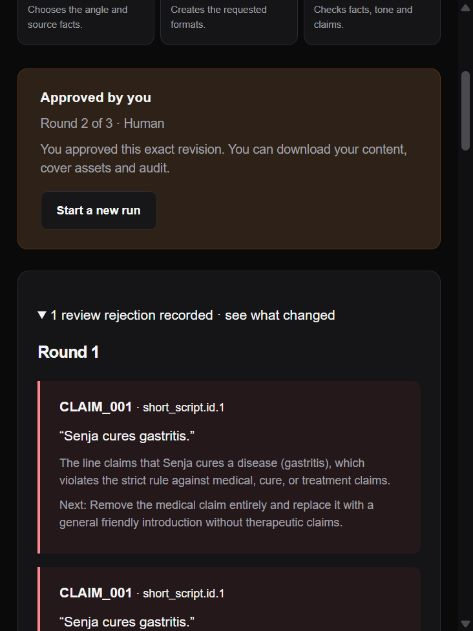

# Challenge C implementation and submission evidence

Reviewed against handbook pp.8–11 and general submission/accountability requirements. Current workflow: **Product launch**, for beginner creators and small sellers. The reviewed-content workflow is now connected to **Video studio** for a finished vertical MP4, with optional YouTube creative inspiration and existing stock search. Product claims remain source-bound. See [complete video evidence](COMPLETE_VIDEO.md) for the new acceptance run and its limitations. Agents still cannot approve or release video files.

## Requirement matrix

| Handbook criterion | Implementation | Verification |
|---|---|---|
| At least three explicit roles | Planner, Writer, independent Reviewer, separate prompts/contracts and trace entries | Real Gemini generation; synthetic workflow contract tests |
| At least two formats from source facts alone | Short-video script, social caption, optional marketplace listing; exact fact IDs/quotes | Exact requested format/language validation; fabricated evidence/number cases |
| Review every draft against documented rules | Facts, medical claims, tone, advertising, halal, translation consistency, untrusted input | Every-line coverage required; cited rule/line/quote/reason/fix; incomplete review fails closed |
| Reject → remediate → approve | Reviewer findings return to Writer; all lines reviewed again; human approval follows | Real Gemini medical-claim edit rejected and repaired, then website approval and ZIP download |
| Stop after at most three rounds | Fixed iteration bound and 80-second execution budget | Three persistent rejections escalate and export remains blocked |
| Human approval before publication | Exact current revision and source; operator session required | Connector approval denied; preapproval export denied; no publication tools |
| Exchange/revision history | Source/rule snapshots, role inputs/outputs/prompts, issues, timestamps, linked human edits | Audit view and exported audit JSON |
| Learn brand tone (bonus) | Most recent own approved examples supplied to agents | Approved-example reuse test; no foreign-owner history |
| Cover assets + text validation (bonus) | SVG cover per format/language, escaped and round-trip checked | 6 covers in real exported pack; long text and XML escaping checks |
| ID/EN/Mandarin consistency (bonus) | All selected combinations, same source fact coverage; semantic Reviewer | Real six-version pack; mismatched evidence coverage rejected |
| Edits propose new rules (bonus) | Human edits create separate tone proposals; no auto adoption | Fresh review/invalidation and separate rule-approval test |

## Evidence and measured results

The automated suite uses **synthetic** cases and simulated provider responses. It is not the organizer's official dataset or official approximately 20-case assessment. The supplied handbook was available; the actual fictional-company product sheets/rulebook and official case pack were not provided. Run those when obtained and retain failing screenshots too.

Current automated results are recorded in [CREATOR_TEST_RESULTS.md](CREATOR_TEST_RESULTS.md). Repeat with `uv run pytest -q`. Test XML and complete run records are in the ignored local `test-results` folder; they contain fictional test data, not provider keys.

Real Gemini 3.5 Flash-Lite test, 1 November 2026:

- Planner → Writer → Reviewer produced **two formats × three languages** in **10.67 s**.
- An operator edit inserted **“Senja cures gastritis.”** The real Reviewer rejected it with `CLAIM_001`; Writer repaired it and Reviewer passed the revised content in **13.44 s**.
- Export returned 409 before human approval. Browser login, review, explicit confirmation, approval and download succeeded. The downloaded ZIP contained **6 text files + 6 SVG covers + source/rules/audit JSON**.
- The explicit `obat maag` direction halted at Planner and escalated with `CLAIM_001` and a safe alternative in **1.83 s**. Record: `test-results/creator-clarification/run.json`.
- Browser warning/error log was empty for that journey. Initial mobile-width rendering was visually checked.
- A second full journey on the final server created a project, loaded/saved fictional facts, called Gemini, automatically corrected an invalid source quote, and received website approval. All three roles were recorded; the invalid quote was blocked despite a permissive semantic review. This also exercised approved tone examples without allowing them to replace the current source.
- These are individual local observations, not averages, performance guarantees, legal certification, or proof of user time savings. Usability/confidence should be measured with beginner creators.

Local artifacts: `test-results/creator-live/report.json`, `generation.json`, `revision.json`, `approved-content.zip`. Re-run the opt-in `scripts.check_creator_live` only when you intend to call the real Gemini API. Its isolated local test account is not a production credential.

Screenshots:

Integration issues encountered and corrected: first generation used 2.5 Flash-Lite and received 404 because it was unavailable to new accounts. Google's native API response recommended 3.5 Flash-Lite; the new default then succeeded. The first regression pass found an older MCP research-compaction helper had been removed; it was restored as an unexposed compatibility helper. No failure was converted into model approval.

## What still needs external evidence

1. **Actual WorkBuddy use in the build/workflow.** The handbook requires developing with WorkBuddy. A five-tool MCP connector and an exported skill are implemented, but Gemini execution and a protocol test do not prove WorkBuddy usage. Run the workflow in the actual WorkBuddy app and retain screenshots/exported traces. The handbook describes complimentary credits; no paid subscription was activated here.
2. **Official organizer cases and data.** Run the provided rulebook and cases once received. Workspace rules are conservative internal policy with handbook citations; they are not a substitute for an official rulebook or formal regulatory review.
3. **Recorded 5–8 minute demo.** The ready-to-record script below is provided; a script is not a recorded video.
4. **Public source link or exported WorkBuddy workflow plus real evidence.** Public publication/submission has not been performed. The personal connector package contains a token: revoke/strip it before sharing. Never publish `.env`, `.data`, or test account databases.
5. **Public demo URL (bonus).** The local test URL is not a public deployment. Existing Turso is supported; account/data migration and service restarts must be deliberate.

## Submission copy

**Title:** TrendForge — The Creator Agent

**Blurb (8 words):** Create with confidence through grounded drafts and review.

**Description:** Beginner creators often spend more time deciding what to say and checking claims than producing content. TrendForge turns one verified product sheet into scripts, captions and marketplace copy. A Planner selects a useful angle, a Writer creates every chosen format and language, and a Reviewer checks every line against documented factual, brand, advertising and halal rules. Rejections cite a rule and an actionable fix. The Writer repairs the draft and resubmits; unresolved issues stop after three rounds. The creator reviews and approves the exact revision before downloading text, covers and a complete audit. English controls and visible source quotes make the review process approachable. Bahasa Indonesia, English and Mandarin outputs share the same source coverage. The local six-version real Gemini check completed in 10.67 seconds; a forced reject/repair check took 13.44 seconds. These timings describe technical feasibility; production time savings and confidence improvements remain user-study questions.

**Architecture/prompts:** [CREATOR_ARCHITECTURE.md](CREATOR_ARCHITECTURE.md); exact role prompts are in `trendforge/creator.py` and saved into new run traces. **Accountability:** [ACCOUNTABILITY.md](ACCOUNTABILITY.md). **Testing:** [CREATOR_TEST_RESULTS.md](CREATOR_TEST_RESULTS.md).

**WorkBuddy product sharing:** Complete this after actual use: identify the exact build/workflow task WorkBuddy performed, attach its real output/trace, explain which role handoffs were useful, and describe one observed limitation. Do not claim it built or executed steps that were performed only by Gemini or this coding session.

## Ready-to-record demo: approximately 6 minutes 30 seconds

| Time | Show | Explain |
|---|---|---|
| 0:00–0:45 | Project page | A beginner seller wants useful content without inventing claims. One source, multiple formats, visible review. |
| 0:45–1:30 | Fictional product facts and rules | Identify facts, source evidence, selected formats/languages. Open medical/halal rules; no source testimonial is proof. |
| 1:30–2:15 | Start a real run | Show distinct Planner, Writer and Reviewer exchanges, source IDs and line checks. Keep a saved actual run ready if quota is exhausted; label any replay clearly. |
| 2:15–3:30 | Edit a line to the fictional medical claim | Submit to fresh review. Show real rejection, rule citation, Writer's repaired copy and new review. No export before approval. |
| 3:30–4:15 | ID/EN/Mandarin outputs | Compare the same fact IDs and quantities; inspect the evidence and approved tone examples. |
| 4:15–5:00 | Approve and download | Read revised copy, tick human confirmation, approve exact revision. Open text, cover and audit from the ZIP. |
| 5:00–5:45 | Saved escalation + audit | Show a genuinely recorded three-failure synthetic case, clearly labeled simulated, or an actual clarification run. Explain limits and no publishing authority. |
| 5:45–6:30 | Architecture, test results, real WorkBuddy evidence | Explain ownership/permission boundaries, measured timings, remaining limitations and actual WorkBuddy learnings. Do not substitute connector installation for evidence. |

For the 90-second surprise test: paste the supplied facts and requested angle, choose two formats and one language, save, run, inspect cited findings and stop for human approval. The 80-second execution limit leaves a small review margin, but provider quota/latency can still cause escalation; disclose that outcome.
