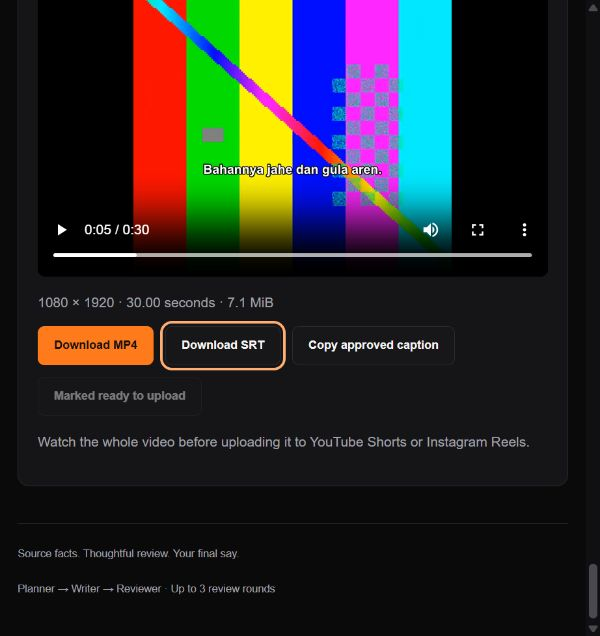

# Complete video acceptance — 1 November 2026

The product now connects the three-agent content workflow to the existing FFmpeg/faster-whisper pipeline. The working website includes Trend research, Source & rules, Create & review, Video studio and Audit & revisions. Output includes a downloadable vertical MP4, optional SRT, approved caption, and the existing text/cover/audit ZIP.

## What was actually verified

- Full regression: **101 passed, 2 skipped in 112.51 seconds**. The skipped cases require a separate Turso test database; no production database was cleared. The targeted video/reference suite also passed: 3 tests in 13.73 seconds.
- New acceptance test takes a three-agent reviewed script through approval, real three-clip uploads, automatic trim/sequence, cut approval, FFmpeg draft, subtitle approval, burned-in subtitles, final export, MP4/SRT download and readiness confirmation. It verifies rejection of stale or unreviewed content and loss of release eligibility after a source change.
- Browser run on port 8768 used the previously real-Gemini-generated, human-approved fictional Senja script. Through the website it selected that script, uploaded three 11-second clips, created a 30-second cut, approved it, rendered a draft, transcribed audio, saved corrected subtitles, approved them, exported, and downloaded the MP4.
- Inputs were **owned synthetic moving test patterns and locally synthesized test speech**, not creator/customer footage. Windows' installed English voice pronounced Indonesian words with an accent. faster-whisper generated **9 actual ASR cues** with word errors; all were corrected through the website before release. This proves the ASR and correction path, not Indonesian transcription accuracy on representative creators.
- Downloaded output: **7,456,243 bytes**, **30.004 seconds**, **1080×1920**, **30 fps**, **H.264**, **AAC stereo 48 kHz**, yuv420p. A full FFmpeg decode completed without errors. A decoded frame visibly contains the reviewed subtitle. Browser playback loaded successfully without a media error.
- Real provider checks returned **20 YouTube references** and **5 stock-search results** using configured keys. An initial YouTube request during rendering correctly returned JOB_ACTIVE; the repeat after rendering returned 200. Stock search was checked, while the video used owned uploads, not a live stock import.
- `db.py` connected to the configured **Turso** database and `SELECT 1` succeeded. The full video run used isolated SQLite/local storage; this is not a claim that destructive Turso media tests ran.

Local evidence: `test-results/full-video-regression.xml`, `test-results/complete-video-tests.xml`, `test-results/creator-video-acceptance.xml`, `test-results/complete-video/report.json`, `actual-asr.json`, `browser-final.json`, `final-frame.png`, `youtube-check.json` and `provider-check.json`. These contain test data and no provider keys. The downloaded sample and SRT are in `outputs/TrendForge_video_demo.mp4` and `outputs/TrendForge_video_demo.srt`.

## Boundaries and recovery

`creator/video-brief` is operator-only and binds an exact approved short-video script/run/source to the video. Subsequent upload/plan/processing/subtitle/export/file routes validate that binding. Starting new content review or changing the source clears linked timeline approvals. Changes are blocked during active video processing. An altered legacy brief cannot bypass content review. Creator-connected connector tokens cannot approve or release the video.

The local worker claims persisted jobs, reports progress and supports cancellation/retry. Invalid clips and insufficient duration produce actionable failures. An ASR failure retains the completed draft for retry or manual subtitle entry. No-speech confirmation is explicit. No external paid video, speech or generative-image API was added.

## Submission evidence still separate

Actual WorkBuddy usage, the organizer's official dataset/rulebook/cases, a public source or documented workflow release, and a recorded 5–8 minute demo are still external submission tasks. Gemini execution, synthetic test footage and an MCP protocol check must not be presented as evidence of those items. A live public deployment has not been performed. The local test account/data remain separate from production accounts.
