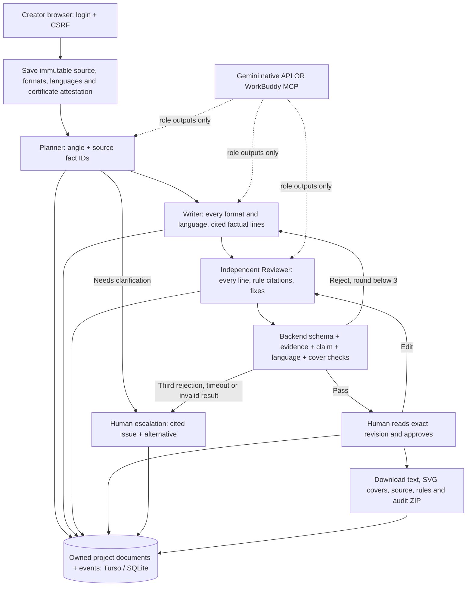

# Creator architecture and contracts

The existing FastAPI service, account security and document database are reused. The new workflow adds one router and a small browser module. No agent framework, vector database, hosted image API or extra model subscription is required. Gemini uses its native generation API through the existing HTTP client; OpenAI-compatible providers remain supported. WorkBuddy can execute the same role contracts through five stdio MCP tools.

## Trust boundaries

The browser session and a personal connector token are separate actors. Middleware checks project ownership on every nested project endpoint; unknown/foreign IDs return 404. Only the website actor saves source, starts/cancels runs, edits, approves tone proposals or releases content. A WorkBuddy connector may read its owner's workspace and submit only the current role/revision. It cannot mint tokens, approve content or export. Models have no tool execution or publication capability.

Source text and all generated text remain data. System prompts describe mandatory rules; proposed tone rules and examples are lower priority. Output is schema-validated and HTML/XML-escaped. JSON schema is supplied to each role. Reviewer omissions and bad rule/quote citations fail closed. Deterministic guards supplement semantic review; a cited substring alone is not treated as proof that a claim is true.

## State and limits

`waiting_for_workbuddy → running → awaiting_approval → approved` is the successful path. Failures produce `escalated`; the operator can cancel active runs. Graceful shutdown records interruption. A persisted deadline lets a subsequent workspace read recover an abandoned running job after a crash. A single server instance per data folder is required; this is an in-process task runner, not a distributed queue.

Iteration 1 starts with Planner, then Writer/Reviewer. A rejection increments the iteration and returns to Writer. Round 3 rejection escalates with outstanding issues. An edited draft starts a new linked run at Reviewer; any required Writer repair is subject to the same bound. The agent budget is 80 seconds with provider requests capped at 25 seconds each. A new manual run is an explicit user action; agents cannot start one to evade the limit.

## API

All paths start `/api/v1`; account authentication applies. Mutations from website sessions require `X-CSRF-Token`. `p` is an owned project; `r` is a real run ID. Validation failures return the existing safe error envelope.

| Method/path | Contract |
|---|---|
| `GET /creator/status` | Engine, model, redacted configured flag, database type and limits. Does not promise provider reachability. |
| `GET /creator/rules` | Documented mandatory rules and execution limits. |
| `GET /projects/{p}/creator` | Current project/source/run, prior runs and tone-rule proposals. |
| `POST /projects/{p}/creator/source` | Website-only validated source snapshot; invalidates current run. Active runs must first finish/cancel. |
| `POST /projects/{p}/creator/runs` | Website-only; required `Idempotency-Key` (1–180 chars). Returns 202 and persisted run immediately. Repeating the current key returns that run. |
| `GET /projects/{p}/creator/runs/{r}/next` | Current role, system prompt, untrusted context, result schema and revision. Connector starts a waiting WorkBuddy run's time budget. |
| `POST /projects/{p}/creator/runs/{r}/step` | WorkBuddy connector only: `{revision, role, result}`; compare revision and engine before persisting. |
| `POST .../runs/{r}/cancel` | Website-only; cancel selected running/waiting run. Late provider results cannot overwrite cancellation. |
| `POST .../runs/{r}/approve` | Website-only: `{revision, confirmation:true}`. Requires current source, exact revision and passed review. |
| `POST .../runs/{r}/edit` | Website-only full Draft object; creates linked fresh review and a proposed tone preference. |
| `POST .../creator/rules/{id}/approve` | Website-only `{confirmation:true}`; adopts tone proposal for future runs. |
| `GET .../runs/{r}/export` | Website-only current human-approved content ZIP. All other states return 409. |

## Stored models

Stored in the existing `documents(id, project_id, kind, data, created_at)` table; no new database service or table is needed. Project pointers identify the current source/run, with existing project revision checks. Historical documents remain available in Audit.

- **Source:** title, 1–20 bounded facts, generated `fact_map` (`F1`...), audience, creative direction, tone, 2–3 unique formats, 1–3 languages and optional certificate reference/issuer/expiry plus explicit verification. Expired or incomplete attestation is rejected.
- **Plan:** angle, approach, real fact IDs, optional `needs_human_input` and clarification.
- **Draft:** every selected format/language pair exactly once. Each content has 1–12 lines: text, `kind=fact|creative`, evidence `{fact_id, quote}`. Creative lines may introduce no new facts and still undergo semantic review.
- **Review:** passed flag, documented-rule issues `{rule_id,line_id,quote,reason,fix}`, one factual check `{line_id,supported,reason}` for **every** draft line. Missing/duplicate checks, fake rules or quotes escalate.
- **Run:** status/stage, iteration ≤3, revision, immutable source/rules/examples, plan/draft, issues, model/engine, timestamps, role prompt/input/output trace, optional parent run, human approval actor/time and request key. Approval is never taken from model output.
- **Tone proposal:** before/after copy, proposed preference, source run, status and separate human approval metadata. Mandatory rules retain precedence.

## Export verification

First lines become deterministic 1080-square SVG covers in the black/orange palette. XML escaping prevents markup injection. Text extracted from the SVG must match the reviewed line after whitespace normalization; overlong openings are sent back for correction. This is text/serialization validation, not OCR or a guarantee that every device has a Mandarin font. Text files preserve the complete copy. These are cover assets, not AI-generated photography or completed videos.
