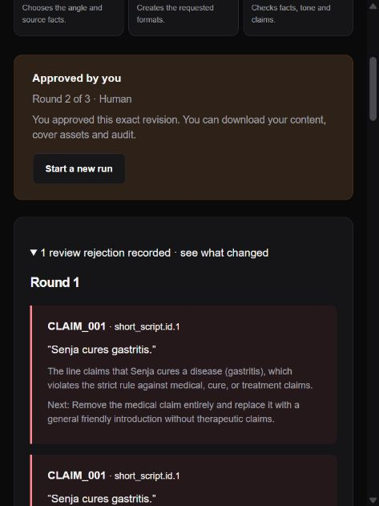
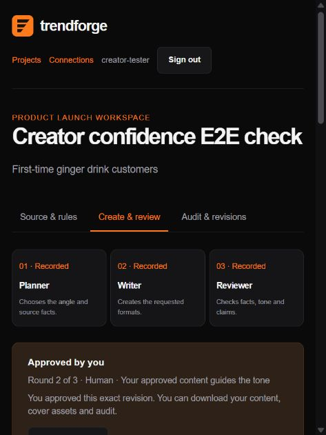
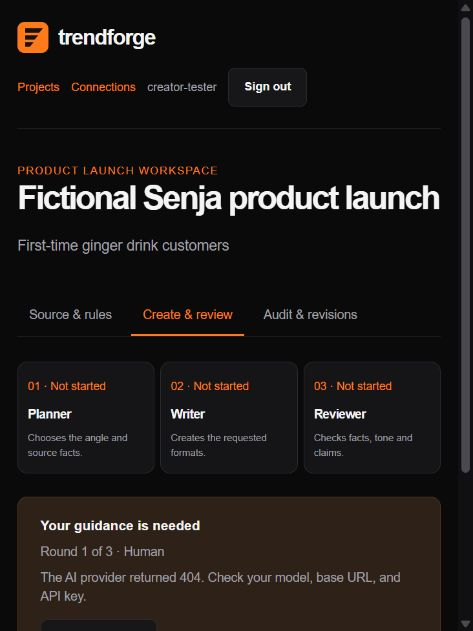

# Creator verification — 1 November 2026

## Automated regression

Command: `uv run pytest -q --junitxml=test-results/all-tests.xml`

**98 passed, 2 skipped, 0 failed in 48.71 seconds.** The skipped cases require an explicitly separate Turso test database. Production Turso was not cleared or repurposed for destructive tests. Existing authentication, ownership, CSRF, video/storage/recovery and connector compatibility tests remain in the regression suite.

After the last cover-width adjustment for full-width Mandarin glyphs, the 32 creator-specific cases were repeated: **32 passed in 4.42 seconds**. JavaScript syntax checks also passed.

The 33 cases in `tests/test_creator_agents.py` are synthetic equivalents of the Challenge C risks. Provider responses are simulated for deterministic coverage; the native Gemini adapter is checked with a simulated HTTP transport. They are not organizer-issued tests or evidence of live model accuracy.

| Cases | Expected result | Result |
|---|---|---|
| Indonesian cure, English cure, Mandarin treatment | Reject `CLAIM_001` | Pass |
| Halal without attestation, Mandarin halal without attestation | Reject `HALAL_001` | Pass |
| Guaranteed results, 100% efficacy, pasti berhasil, zero risk | Reject `AD_001` | Pass |
| Invented quantity | Reject `FACT_001` | Pass |
| Missing evidence, unknown fact, fabricated quote | Reject unsupported evidence | Pass |
| Unequal multilingual fact coverage | Reject `LANG_001` | Pass |
| Overlong cover opening | Reject before release; do not truncate silently | Pass |
| Missing/expired certificate; complete current attestation; expiry after review | Validate fields; reject expired evidence at approval and export too | Pass |
| Complete cycle: 3 roles, rejection, repair, review, human approval | Preserve sequence, block early/stale release, export six versions | Pass |
| Three persistent rejections | Escalate after exactly 3 reviews; no export | Pass |
| Explicit medicine-label request requiring clarification | Escalate with rule and non-medical alternative | Pass |
| Quota error; execution-budget error | Preserve source and fail without approval | Pass |
| WorkBuddy role/revision/ownership/human boundary | Stale or website-submitted agent steps denied; connector approval denied; foreign project hidden | Pass |
| Missing line checks; invented rule; wrong format; bad JSON shape | Fail closed | Pass |
| Unsupported semantic line; brand violation | Return to Writer, never auto-approve | Pass |
| Human edit, proposal approval, original-release invalidation | New review; no automatic rule adoption | Pass |
| Source update while active; stale source approval | Locked active source; stale approval denied | Pass |
| SVG escaping, Mandarin/Indonesian text, excessive length | Text round-trip or explicit rejection | Pass |
| Gemini adapter | Fixed native Google endpoint/header, JSON parsing and redacted status | Pass |

The instruction-injection case preserves the malicious direction as untrusted context and verifies prompt boundaries; simulated outputs cannot prove resistance to every live injection. Semantic hallucination and multilingual quality still require human review.

## Real Gemini and browser journey

Real Gemini 3.5 Flash-Lite, fictional Senja product sheet, two formats in ID/EN/zh:

| Observation | Result |
|---|---|
| Initial Planner → Writer → Reviewer | Awaiting human approval in **10.67 s** |
| Injected `Senja cures gastritis.` through human-edit API | Real Reviewer rejection, cited `CLAIM_001` |
| Writer repair and new Reviewer check | Awaiting human approval in **13.44 s** |
| Explicit request to call a herbal product `obat maag` | Real Planner halted and escalated with `CLAIM_001` and a non-medical alternative in **1.83 s**, before drafting |
| Export before approval | 409, blocked |
| Browser sign-in → review → human confirmation → approval | Passed |
| Browser ZIP download, parsed locally | 15 files: 6 text, 6 SVG, source/rules/audit JSON; persisted status `approved` |
| Browser warning/error log | Empty during tested journey |
| Narrow and wide CSS layout | No horizontal document overflow at observed 488px and 1280px viewport widths; wide content grid has two columns. Narrow layout visually checked; wide viewport screenshot capture was cropped by the browser tool, so it is not claimed as full desktop visual evidence. Override reset afterward. |
| MCP protocol | Real stdio handshake, exactly 5 tools, no approval tools. Temporary test token revoked immediately. This is protocol evidence, not WorkBuddy app usage. |

Individual timings include local API polling. They are not a benchmark average or production SLA. No user-confidence study has been performed.

## Failures retained in this report

- Initial real generation received **404** for `gemini-2.5-flash-lite`; Google's native error said the model was unavailable to new users and recommended 3.5 Flash-Lite. The selected default was updated; real generation and remediation then passed. Its escalated fictional project remains visible in the isolated test workspace.
- The first complete regression run had **1 failure** after a legacy MCP helper was removed. The helper was restored without exposing legacy tools, and the final suite passed.
- Turso destructive integration cases are **skipped**, not reported as passed. Supply `TRENDFORGE_TEST_TURSO_DATABASE_URL` and `TRENDFORGE_TEST_TURSO_AUTH_TOKEN` for a different database before running them.

Not verified: actual WorkBuddy app execution, official fictional-company dataset/cases, a public deployment, recorded demo, real halal-registry validation, legal compliance, all translation nuances, and performance under concurrent production load. See [submission readiness](CHALLENGE_C.md).
